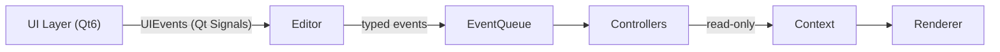
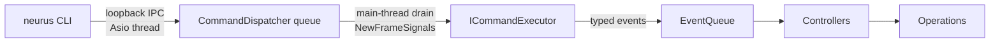
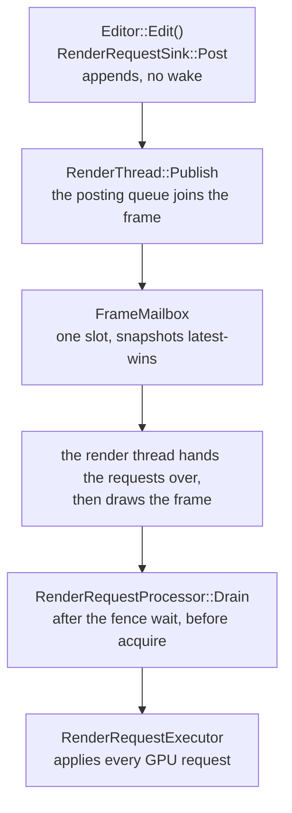

# Data Flow

All cross-layer traffic follows a single unidirectional chain, carried by Qt
signals, typed events and read-only context objects.

## Isolation Chain

Data and control flow follow this strict unidirectional chain:

- UI emits signals via UIEvents. It NEVER calls the Editor or Renderer directly.
- Editor turns each signal into a typed event at the UI boundary
  (`Editor::OnUIEvent`), drains that queue once per frame in `Edit()`, and every
  further hop dispatches synchronously to the controllers.
- Controllers handle discrete events (for example CameraController subscribes to
  CameraEvents) - no per-frame polling.
- Renderer receives read-only scene data through Context objects. It NEVER calls
  back into the Editor.
- Each arrow represents a **decoupled interface** (signals, events, contexts).
  No layer knows the internals of the next.

## Command Path

A command reaches the same editor mutation path from outside the UI:

- The IPC thread never touches the editor. It only parses a framed request and
  queues it.
- The main thread drains at most 16 commands per tick and answers only after
  every controller has run, so a response means the change is applied.
- Query commands read the editor's live state directly; mutations use the same
  typed events as a panel edit, including undo/redo.
- `session.close` writes its response before it asks the application to quit.

## Three Event Paths

Event structs in `src/editor/events/` are split by domain:
`SceneEvents.h` (scene-domain events carrying plain `int objectUid`: selection,
transform, visibility, camera/mesh/light/env property edits), `EditorEvents.h`
(cross-component events: RenderResetEvent, EnvironmentChanged, SceneModified,
LightGpuChanged, LightingRebuild, SceneObjectGpuUploadRequested), and
`AssetEvents.h` (asset add/import: mesh/camera/light adds). Object property
writes are handled by `ObjectController`, which resolves them through the
resource pool; shader edits by `ShaderController`; membership and selection by
`SceneController`, which resolves against the Scene. They emit `EditorEvents` for
GPU uploads and dirty tracking; the Editor executes those uploads.

Cross-layer traffic flows along three distinct paths, all still "UI emits,
Editor wraps or forwards, controllers handle". They differ in who wraps the event
and where it is resolved; **when** it is dispatched is a separate axis - only the
UI boundary is deferred, everything else is synchronous. See
[Events](../editor/events.md#dispatch-paths).

1. **UI -> Editor pure intents** (`InputEvents.h`): the raw input stream -
   mouse move/press/release/scroll plus
   `ObjectClicked { int objectUid; int modifiers; }` and `DeleteRequested { }`.
   These carry no scene; the UI does not hold or stamp the scene.
2. **UI -> Controller editing events** (`SceneEvents.h`, `ShaderEvents.h`):
   complete scene mutations (selection, transform, visibility, property edits,
   shader edits) carrying `int objectUid`. Panels emit these with the active
   object's integer UID; `Editor::OnUIEvent` enqueues them unchanged and
   controllers resolve the UID via their `ControllerContext` - through the pool
   for a property write, against the Scene for membership and selection.
3. **Editor -> Controller wrapped events**: `ObjectSelected` (the Editor
   subscribes to `ObjectClicked` and forwards
   `ObjectSelected { objectUid, modifiers }`, and the Application emits it for
   the viewport IDBuffer pick), `DeleteObjectsRequested` (the Editor subscribes
   to `DeleteRequested` and stamps it with the current selection's UIDs), the
   membership events (`SceneObjectAddRequested` / `SceneObjectDeleteRequested`),
   and the replay / restore events. `CameraEvents` carry `int camId` (resolved
   by the controller).

On the UI->Editor path the UI emits PURE INPUT INTENTS (`InputEvents.h`) that
carry no scene; the Editor wraps them into dedicated scene events
(`ObjectSelected`, `DeleteObjectsRequested`), and controllers handle complete
scene mutations carrying `int objectUid`, resolving the UID to the live object
via their `ControllerContext` (never raw pointers - a UID stays stable after
deletion while a pointer would dangle). The scene itself is not carried in
events: scene-scoped handlers obtain it from the context.

## UIEvents System (Qt Signals)

- QObject singleton with typed Qt signals
- UI panels emit their own signals (for example `Outliner::objectClicked`,
  `RenderConfigPanel::configValueChanged`)
- `Application::ConnectUIEvent<T>` template bridges panel signals ->
  `Editor::OnUIEvent<T>` -> `EventQueue::Enqueue<T>`

## EventQueue System (Typed Event Dispatcher)

- Header-only template-based event dispatcher (no Qt dependency)
- Editor-internal, not an Editor<->Renderer channel: nothing under `src/render/`
  includes it
- Two dispatch paths: `Enqueue` + `Process()` is deferred and belongs to the UI
  boundary only (`Editor::OnUIEvent`, drained once per frame by `Editor::Edit()`);
  `Emit` is synchronous and depth-first and is how everything else inside the
  editor - controllers, operations, script writes - dispatches
- `IEventQueue`, the surface controllers and scripts see, exposes only
  `Subscribe` and `Emit`; `Enqueue`/`Process`/`PendingCount` belong to the
  concrete `EventQueue`, and `Dispatch` refuses beyond 64 live frames
- The Renderer is reached through the frame snapshot and the Editor's posted
  `RenderRequest`s; it never receives an event

## Render Request Path (Editor to Renderer GPU work)

The Editor never touches a `VkQueue`, waits on one or writes the renderer's
resource maps. All GPU work it used to do directly - upload a mesh, allocate a
light's shadow maps, (re)generate IBL, rewrite the light SSBOs, warm a per-mesh
pipeline, drop the outgoing scene's resources, reset accumulation, redraw the
overlays - is posted as a typed `RenderRequest` value and executed by the
renderer on the thread that submits:

Requests posted inside one `Edit()` are executed for the frame that tick
publishes: every Post precedes the Publish, and Publish moves the posting queue
into the frame it hands over. A request posted after a publish rides the next
published frame, so it never runs against a snapshot older than its own tick -
and a frame that was displaced before the render thread took it hands its
requests to the next publish in posting order. Execution is strict FIFO, which is a contract:
an upload posted after `DropSceneResourcesRequest` lands in the new scene, and
one posted before it is discarded with the old one. `RedrawOverlaysRequest` is
the one request that does not restart accumulation: it only marks the overlays
stale, so a converged renderer redraws them over the image it already has. A
payload is a value or a `shared_ptr<const T>` to immutable data - never a
`Scene`, `Mesh` or `Shader` pointer, and never a callable, so the request stays
correct however the Editor edits or deletes afterward. See
[Render request path](../render/resources.md#render-request-path).

## Render Thread (Application to Renderer plumbing)

Once `RenderThread::Start()` runs, the render thread is the only thread that
calls into `DeferredRenderer`. The Application never draws or waits the GPU; it
publishes one `PublishedFrame` per tick and sends control messages
(`src/render/RenderControl.h`) that the thread executes between frames, after
the frame fence:

**One publish per tick carries the tick's requests.** `RenderThread::Publish`
takes the snapshot the Application built and moves the posting queue into it, so
one `PublishedFrame {snapshot, requests}` goes into the latest-wins mailbox.
Requests posted between two publishes travel with the second; `Post` itself
neither wakes the render thread nor invalidates anything, because a request is a
command for the next frame rather than a change to a frame already published.
The mailbox drops snapshots, never requests: a frame displaced by a newer
publish, or dropped by an `Invalidate` (resize, surface change), leaves its
requests behind, and the next publish puts them in front of its own, in posting
order. A frame the render thread reuses to finish an accumulation run carries
none - the loop hands a frame's requests over and clears them before it draws, so
a repeat draw posts nothing.

The control messages are:

- **Resize** - `PostResize(w, h)`, fire and forget; the last resize of a batch
  wins. The viewport gets an estimated physical extent at once and is corrected
  from `Status().extent` when the swapchain reports a different one.
- **Pick** - `PostPick(u, v)` with coordinates normalised to the viewport; the
  thread maps them onto its own extent and reads the ID buffer. The click
  handler never waits: it keeps the future, and each UI tick polls it before
  `Edit()` and applies the answer as an `ObjectSelected` event once ready. A
  newer click replaces an unanswered one; a failure, or a transform gesture
  started in the meantime, keeps the current selection.
- **Surface change** - the new surface is created on the main thread (it needs
  the native window); `PostSurfaceChange` rebuilds the swapchain and the main
  thread waits up to 2 s before destroying the old surface. On timeout or
  failure neither surface is destroyed until shutdown.
- **Screenshot** - `PostScreenshot(allAttachments, directory)`, fire and forget.
  The Application resolves `directory` from the executable location (Qt's
  `applicationDirPath()`), because the process working directory is not under
  the user's control; the render thread hands the path to the renderer
  unchanged, so the Renderer stays Qt-free.

Resize and surface change invalidate the mailbox: both restart accumulation,
so a snapshot published before them would seed frame 0 with a stale camera or
extent. Pick and screenshot only wake the loop - they read whatever was drawn
last and must neither discard nor force a frame. A `RenderRequest` does neither:
it rides the next publish and so executes with the snapshot of its own tick.

**Waiting is driven by the work left, not by the tick.** `DeferredRenderer` draws
`r_sampling_count` scene frames after every restart and then stops, so a
publisher that keeps publishing must not keep the GPU busy for nothing. Before
each wait the thread asks `IFrameRenderer::NextWork()`: `Sample` reuses the
snapshot it already holds (`AcquireMode::Reuse`), `Overlay` and `Retry` wait for
a fresh one, and `Idle` parks on the mailbox without acquiring a swapchain image
(`AcquireMode::Idle`), ignoring request-free published frames until a control
message arrives - or taking one that carries requests, so a converged viewport
still sees the edit. A converged viewport therefore costs one parked thread and
no presents.

Shutdown: after the Qt event loop returns, `RenderThread::Stop()` joins the
thread (which breaks any pending promise and leaves the graphics queue idle)
before any GPU member is destroyed.

## Context System (Data)

Two frame views over the same document state, with the Editor as the single
pivot, so neither consumer reaches around it for the other's data:

- `RenderContext` (`src/render/RenderContext.h`) - the renderer's view. The
  Editor half is a single owned frame snapshot: the Application publishes one
  `PublishedFrame` per tick (the `Editor::BuildSnapshot()` snapshot plus that
  tick's requests), and the render thread points `ctx.snapshot` at the snapshot
  of the frame it is drawing; `DeferredRenderer` then stamps the frame half (`width`,
  `height`, `frameIndex`, `jitter`, `iteration`) through `recordFrame()`. There
  is no second publication path - a pass reads what is being rendered through
  `ctx.Frame()`.
- `UIContext` (`src/ui/UIContext.h`) - the UI's view, two fields wide: `scene`
  and `config` from `Editor::UpdateUIContext()`, plus the Application's typed
  `profile`/`log`/`history`/`scriptConsole` pointers. A panel never names the
  camera or either overlay payload.
- Read-only access to scene data for Renderer
- Data flows: Editor mutates, Renderer consumes
- **`RenderContext` carries the Editor half as one forward-declared
  `const RenderFrameSnapshot*`** (`src/render/RenderFrameSnapshot.h`) - an owned
  deep copy with no Scene pointers and no lazy reads, so the renderer reads values
  the Editor is free to keep mutating. `UIContext`'s members stay typed pointers
  declared by forward declaration (`const Scene*`, `const RenderConfig*`,
  `const FrameProfile*`, `const LogBuffer*`, `const HistoryView*`,
  `const ScriptConsoleBuffer*`), and **growth is by a new typed field on whichever
  view owns its source** - never by a `void*` slot. A forward declaration adds no
  include, so the typed pointer costs the layer isolation nothing; the type
  erasure it replaced cost 18 `static_cast` sites and two wrong null policies.
- `RenderConfig` (`src/core/RenderConfig.h`) is owned by the Editor directly
  (no longer via Project); `BuildSnapshot()` copies it into the snapshot, where a
  pass reads it through `ctx.Frame().Settings()`, and a panel reads the Editor's
  copy through `UIContext::Settings()`. Neither returns null - both fall back to
  `DefaultRenderConfig()`, the single source of truth for render-setting defaults,
  so a pass and a panel cannot disagree about an unset value
- Null policy: `ctx.Frame()` itself is never null - an unpublished context reads
  as an empty frame (no scene, no camera, no draws, default settings), so what a
  pass used to null-check on the context it now checks on the frame
  (`ctx.Frame().HasScene()`, `HasCamera()`, `HasDebugDraw()`). On `UIContext`,
  `config` is always safe through `Settings()` while `scene` MUST be checked
  (`HasScene()`)
- `Editor::SetRenderConfig()` writes UI config changes directly to the
  Editor-owned RenderConfig, which then reaches the renderer in the next frame's
  snapshot and the UI through `UpdateUIContext()`
