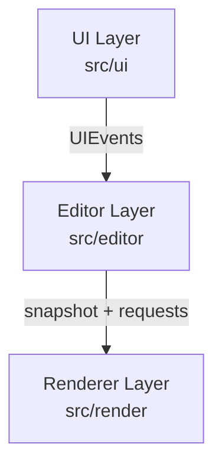
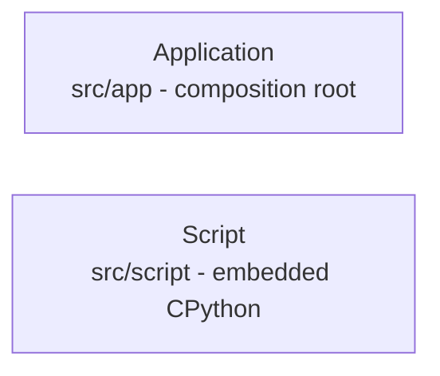
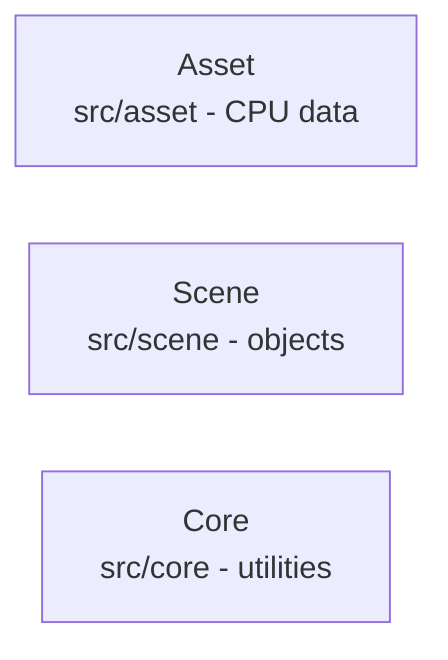
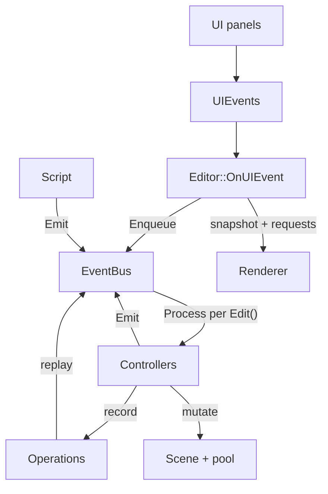
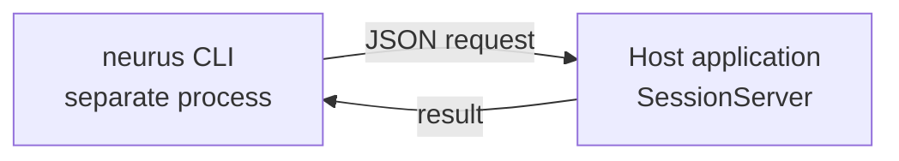

# Architecture Overview

Neurus is a C++20 Vulkan-HPP 1.4 real-time renderer designed for experimentation
with modern rendering algorithms, organized into strictly isolated layers.

## System Design Philosophy

The architecture prioritizes:

- **Strict layer isolation** - UI, Editor, Renderer, Script and Command
  boundaries must not be violated
- **Minimal global state** - State is explicit and localized
- **Explicit data flow** - Communication via UIEvents (Qt Signals/Slots),
  typed `RenderRequest` values (Editor to Renderer), Context objects, and typed
  editor events (Script to Editor); the `EventQueue` typed dispatcher stays
  inside the Editor
- **Stateless rendering** - Renderer does not own application-level state
- **Deterministic GPU resource management** - Vulkan resources have explicit
  RAII ownership via the `vk::raii` namespace

## Layer Diagram

The remaining layers sit outside that chain:

The shared, Vulkan-free libraries:

### The event bus is the pivot

Every editor mutation crosses one node, whichever layer starts it:

The bus carries four paths, and they differ only in who starts the walk:

- **UI intent**: `UIEvents` -> `Editor::OnUIEvent` -> `Enqueue` -> `Process` -> controllers.
- **Script write**: `ScriptDispatch::Emit` -> controllers, synchronously.
- **Undo / redo**: a controller records an `Operation`; `Apply()` re-emits the
  original event through the bus, so replay runs the same handler a live edit
  runs.
- **GPU work**: controllers mutate the Scene, and the Editor posts
  `RenderRequest`s and publishes the frame snapshot to the Renderer - the
  Renderer never sees an event.

A command arrives from a separate process:

Scene objects (`src/scene/`) and Core utilities (`src/core/`) are shared across
layers.

The Application layer is the composition root. It creates the window, the
Vulkan context and surface, the editor, the renderer and its thread, the script
engine and the session server. One tick drains session commands first, then runs
queued scripts, then applies a finished pick, and only then calls `Editor::Edit()`,
builds the frame snapshot, publishes it and refreshes the UI from `UIContext`.
Commands and scripts therefore see their mutations applied in the tick that
issued them.

### Generated Structure Graph

<!-- The link below is raw HTML on purpose. graphify.html is generated build
     output and gitignored, so a markdown link would be reported by MkDocs link
     validation and fail `mkdocs build --strict` on any build where the graph
     has not been generated (a plain `mkdocs serve`, or a CI run where the
     non-fatal graphify step failed). Raw hrefs are passed through unvalidated
     AND unrewritten, so this path is URL-relative to /architecture/overview/,
     not source-relative like a markdown link would be. That is also why the
     call to action below is a raw <a class="md-button"> rather than
     attr_list's [text](url){ .md-button }, which would be validated. -->

The diagrams above are hand-maintained. For a generated counterpart, the
structure graph maps the
classes and functions in `src/` and the calls, inheritance and containment
between them, grouped into communities that track the layer boundaries above. It
is built from tree-sitter ASTs by
[graphify](https://github.com/Graphify-Labs/graphify) during the documentation
build; regenerate it with `make doc`. Shaders do not appear, and the page needs
network access to load its layout engine.

<a href="../../graphify.html" target="_blank" rel="noopener" class="md-button md-button--primary">Open the structure graph</a>
