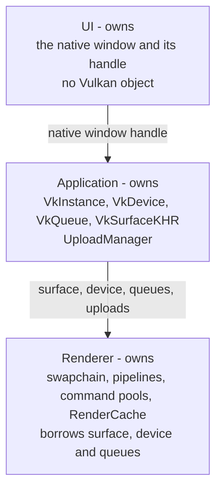

# Ownership

Vulkan resources are owned by exactly one layer: the Application owns the
instance, device, queues and surface, the Renderer owns the swapchain and every
resource below it, and the UI owns only the native window.

## Vulkan Ownership Graph

The handles, in full:

- **UI**: the native window and its handle; it creates no Vulkan object.
- **Application**: `VkInstance`, `VkDevice` and `VkQueue` (in `VulkanContext`, no
  `QVulkanInstance`), `VkSurfaceKHR` from `platform::CreateSurface()`, and the
  `UploadManager`.
- **Renderer**: `VkSwapchainKHR` (borrowing the surface, device and queue),
  pipelines and layouts, command pools and buffers, `RenderCache` with its lazy
  `GetAttachment` / `GetShadowMap` / `GetShadowIntensityArray`, and every
  framebuffer attachment.
- **Through `src/render/` abstractions**: `Buffer` (`GPUBuffer`, `StagingBuffer`,
  `UniformBuffer<T>`), `Image` / `Texture`, `DescriptorManager`,
  `Barrier::Transition`, and the `MeshGPU`, `EnvironmentGPU` and `LightingCache`
  tables `RenderCache` holds.

- **Borrowed from the Application**: the `UploadManager`, created there, handed
  over with `DeferredRenderer::SetUploadManager()` and driven by
  `RenderRequestExecutor`; it outlives the renderer.

The renderer is the **sole GPU submitter**: every `VkQueue` submit, every wait
on queue work (a frame-fence drain or a graphics-queue idle) and all writes to
the RenderCache's resource maps happen on the renderer's own thread. The Editor
drives GPU state only by posting a
`RenderRequest` (see [Data Flow](data-flow.md#render-request-path-editor-to-renderer-gpu-work));
`DeferredRenderer` drains the queue per frame and its `RenderRequestExecutor`
performs the work. Single ownership is the point, not tidiness: every device
uploads through the graphics queue family, so an upload submitted from one thread
while a frame is submitted from another is a race on the one `VkQueue` handle
that no cache lock repairs. With every submit issued by the renderer on its own
thread, that queue has exactly one user.

Scene and Asset layers own NO GPU resources. The Editor posts an
`UploadMeshRequest` carrying the mesh's `MeshData`; the renderer uploads it and
holds the resulting `MeshGPU` in a refcounted table, and each submitted frame
keeps the table it drew with until its fence. `ImageData`
provides CPU-side pixel buffers; GPU upload goes through `Image::FromImageData`.
The `GeometryRenderItem` struct that previously mixed CPU and GPU concerns has
been removed.

## Ownership Rules

- The Application owns `VkInstance`, `VkDevice`, `VkQueue` and
  `VkSurfaceKHR`; the surface is created from the viewport's native window
  handle with `platform::CreateSurface()`. There is no `QVulkanInstance`.
- The Renderer borrows the surface, device and queue, and owns the swapchain,
  pipelines, command pools and every GPU resource below the swapchain.
- The UI owns the native window and its handle; it creates no Vulkan object.
- No shared ownership of GPU resources across layers
- Non-copyable GPU resource classes (`= delete` copy/assign)
- Each Vulkan handle has one owning layer

## Architectural Invariants

1. **No cross-layer direct coupling** - Use UIEvents/EventQueue/RenderRequest/Context only
2. **Renderer is stateless** - Application state lives in Editor
3. **Renderer is the sole GPU submitter** - the Editor drives GPU state only by
   posting a `RenderRequest`; it never submits, waits the queue, or writes the
   renderer's resource maps
4. **Full RAII** - No two-phase initialization; no `Init()`/`Terminate()` methods
5. **Explicit GPU ownership** - Each Vulkan handle has one owning layer
6. **Non-copyable GPU resources** - `= delete` copy/assign
7. **Vulkan validation** - Debug builds enable `VK_LAYER_KHRONOS_validation`
