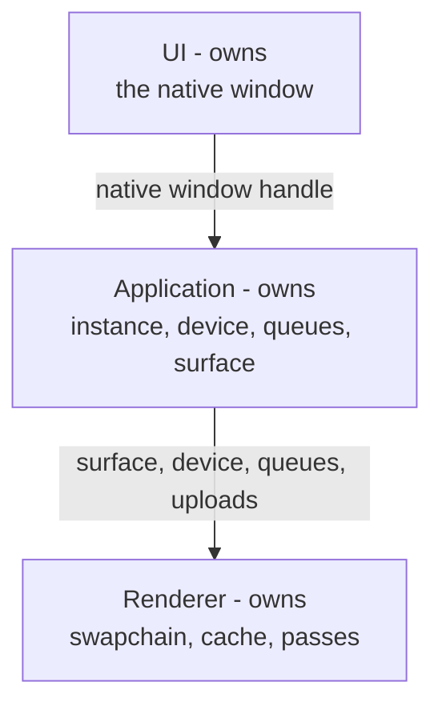

# Ownership

Vulkan resources are owned by exactly one layer: the Application owns the
instance, device, queues and surface, the Renderer owns the swapchain and every
resource below it, and the UI owns only the native window.

## Optional project render data

Editor owns nullable `shared_ptr` config and graph slots; explicit shader data
belongs to its resource pool. Null means use defaults and is omitted on save.
Read-only effective getters do not allocate stored project data. Explicit edits
materialize values, and config undo restores absence as well as field values.

`ApplicationCore` supplies one `BuiltInRenderData` service to the Editor and
renderer. The service compiles and caches default CPU shaders, ports and graph
separately from project data. Renderer owns the GPU resources derived from it.
The frame mailbox carries effective config by value, keeping mutable project
pointers off the render thread.
UI reads a frame-scoped view; scripts re-query config through a read-only
provider after edits or undo can replace the stored pointer.

## Graph shader ownership

An authoring `CpuNode::shader` is a `PassShaderRef` with shared ownership of its
pooled CPU shader. An empty reference selects the pass default. The Editor retains mutable
access to that resource. Publication clones graph topology, preserving shared
shader ownership. The graph mapper reads only the stable shader UID from these
references, never mutable source, parsed IR, SPIR-V or version fields.

CPU preparation copies SPIR-V and required reflection/port metadata into owned
`UploadShaderRequest` values through `MakeUploadShaderRequest`. FIFO execution
uploads these before mapping the graph. `UploadManager` constructs `ShaderGPU`;
`RenderCache` owns and indexes it. Passes consume GPU shader modules and own their
pass-specific pipelines. Reuploading the same UID changes its GPU cache revision
and refreshes dependent passes and graphs. Retained resource references and
frame fences keep resources alive until recorded GPU work has finished.

Defaults follow the same path: built-in recipes are prepared on the CPU, uploaded,
cached and consumed by passes. CPU defaults stay outside the project pool;
renderer-owned GPU defaults and custom shaders never change serialized state.

## Vulkan Ownership Graph

The handles, in full:

- **UI**: the native window and its handle; it creates no Vulkan object.
- **Application**: `VkInstance`, `VkDevice` and `VkQueue` (in `VulkanContext`, no
  `QVulkanInstance`), `VkSurfaceKHR` from `platform::CreateSurface()`, and the
  `UploadManager`.
- **Renderer**: `VkSwapchainKHR` (borrowing the surface, device and queue),
  pipelines and layouts, command pools and buffers, `RenderCache` with its uploaded `ShaderGPU` modules and lazy
  `GetAttachment` / `GetShadowMap` / `GetShadowIntensityArray`, and every
  framebuffer attachment.
- **Through `src/render/` abstractions**: `Buffer` (`GPUBuffer`, `StagingBuffer`,
  `UniformBuffer<T>`), `Image` / `Texture`, `DescriptorManager`,
  `Barrier::Transition`, and the `MeshGPU`, `EnvironmentGPU` and `LightingCache`
  tables `RenderCache` holds.

- **Borrowed from the Application**: the `UploadManager`, created there, handed
  over with `DeferredRenderer::SetUploadManager()` and driven by
  `RenderRequestExecutor`; it outlives the renderer.

The renderer is the **sole GPU submitter**: every `VkQueue` submit, every wait
on queue work (a frame-fence drain or a graphics-queue idle) and all writes to
the RenderCache's resource maps happen on the renderer's own thread. The Editor
drives GPU state only by posting a
`RenderRequest` (see [Data Flow](data-flow.md#render-request-path-editor-to-renderer-gpu-work));
`DeferredRenderer` drains the queue per frame and its `RenderRequestExecutor`
performs the work. Single ownership is the point, not tidiness: every device
uploads through the graphics queue family, so an upload submitted from one thread
while a frame is submitted from another is a race on the one `VkQueue` handle
that no cache lock repairs. With every submit issued by the renderer on its own
thread, that queue has exactly one user.

Scene and Asset layers own NO GPU resources. The Editor posts an
`UploadMeshRequest` carrying the mesh's `MeshData`; the renderer uploads it and
holds the resulting `MeshGPU` in a refcounted table, and each submitted frame
keeps the table it drew with until its fence. `ImageData`
provides CPU-side pixel buffers; GPU upload goes through `Image::FromImageData`.
The `GeometryRenderItem` struct that previously mixed CPU and GPU concerns has
been removed.

## Ownership Rules

- The Application owns `VkInstance`, `VkDevice`, `VkQueue` and
  `VkSurfaceKHR`; the surface is created from the viewport's native window
  handle with `platform::CreateSurface()`. There is no `QVulkanInstance`.
- The Renderer borrows the surface, device and queue, and owns the swapchain,
  pipelines, command pools and every GPU resource below the swapchain.
- The UI owns the native window and its handle; it creates no Vulkan object.
- No shared ownership of GPU resources across layers
- Non-copyable GPU resource classes (`= delete` copy/assign)
- Each Vulkan handle has one owning layer

## Architectural Invariants

1. **Application wires the layers.** UI signals and script dispatch feed typed
   editor events. Editor supplies owned snapshots and posts GPU requests.
   Application publishes frames and posts render-thread controls. The concrete
   event queue stays inside Editor. See [Data Flow](data-flow.md).
2. **Renderer is stateless** - Application state lives in Editor
3. **Renderer is the sole GPU submitter** - the Editor drives GPU state only by
   posting a `RenderRequest`; it never submits, waits the queue, or writes the
   renderer's resource maps
4. **Full RAII** - No two-phase initialization; no `Init()`/`Terminate()` methods
5. **Explicit GPU ownership** - Each Vulkan handle has one owning layer
6. **Non-copyable GPU resources** - `= delete` copy/assign
7. **Vulkan validation** - Debug builds enable `VK_LAYER_KHRONOS_validation`

UI native window handles use the Vulkan-free `platform/NativeWindow.hpp`.
`platform/PlatformSurface.hpp` exposes Vulkan types and belongs at the Application
and GPU-platform boundary; UI headers must not include it.
