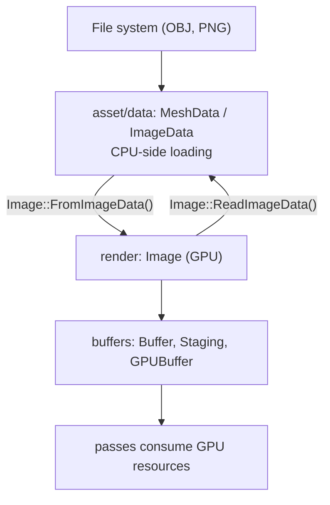

# Data Resources

The asset layer holds Vulkan-free CPU-side data resources - pooled mesh geometry and image pixels - and the format and path helpers that keep them portable.

## Asset layer scope

The asset layer (`src/asset/`) manages the loading, storing and provision of external asset data (meshes, images). It is Vulkan-free: no Vulkan includes appear in public headers, and format queries use the `PixelFormat` enum rather than raw `vk::Format` values. GPU resource abstractions (buffers, images, descriptors) are owned by the renderer layer.

See [Layers](../architecture/layers.md) and [Ownership](../architecture/ownership.md).

## MeshData (`asset/data/MeshData.hpp`)

`MeshData` is a pooled resource (`UID` base) holding CPU-side mesh geometry parsed from OBJ files:

- `ByteArray` holds the interleaved vertex data (14 floats per vertex: position 3, normal 3, uv 2, tangent 3, bitangent 3), the `uint32_t` index array, a bounding-box `center`, and a mesh `name` from the OBJ.
- The path constructor stores the source path and loads content immediately, so the resource is ready after `ResourceManager::Load<MeshData>(path)`.
- `LoadObj(path)` and `LoadObjFromString(content)` parse OBJ; `ReloadContent()` re-parses from disk and is called on construction and at the end of `serialize(load)` (a no-op when the path is empty, for procedural/test data).
- `serialize` writes the `UID` base plus `m_path`, then reloads content on load, so the resource is self-contained with no pool hook.
- Getters: `GetMeshData()`, `GetMeshCenter()`, `GetMeshName()`, `GetPath()`, `GetVertexCount()`, `GetIndexCount()`.
- Parsing triangulates triangles, quads and n-gons; computes per-face normals when the file provides none; computes tangents and bitangents; and deduplicates vertices through a position/uv/normal key.
- Non-copyable and non-movable (UID identity); held via `shared_ptr`.

The source path lives here, in the data layer - scene objects wrap a `MeshData` and never hold the path themselves.

## ImageData (`asset/data/ImageData.hpp`)

`ImageData` is a pooled resource (`UID` base) owning raw CPU-side pixels:

- Owns a `std::vector<uint8_t>` alongside width, height and `PixelFormat`.
- The path constructor auto-detects HDR versus LDR with `stb_is_hdr()`: HDR images (`.hdr`) load as `RGBA32F`, LDR images (`.png`, `.bmp`, `.jpg`, `.tga`) load as `RGBA8S`. It stores the path for later `ReloadContent()`.
- The raw-data constructor copies `data` into the owned vector, sized `w * h * PixelByteSize(fmt) * arrayLayers`.
- `serialize` writes the `UID` base plus `m_path`, then reloads on load.
- `IsValid()` is true when dimensions are non-zero and pixel data is non-empty.
- Getters: `GetPixelData()`, `GetWidth()`, `GetHeight()`, `GetFormat()`, `GetPath()`, plus convenience `PixelByteSize()` and `ChannelCount()`.
- `SavePNG(path, remapSigned)` and `SaveHDR(path)` write the owned pixels to disk (CPU-side only); `SaveHDR` expects `RGBA32F` data and emits Radiance RGBE.
- Static helpers: `ConvertHalfToU8`, `ConvertFloatToU8` (both with an optional signed remap for normals), and `SwizzleBGRtoRGB`.
- Non-copyable and non-movable (UID identity); held via `shared_ptr` (for example `Environment::o_equirectData`).

Like `MeshData`, the source path lives in the data layer.

## ShaderData (`asset/data/ShaderData.hpp`)

`ShaderData` is the pooled CPU-side shader bundle and the UID a script
addresses. Its supporting IR/unit headers live under `asset/data/shader/`
(`ShaderStage.hpp`, `ShaderStruct.hpp/.cpp`, `ShaderUnit.hpp`,
`ShaderStructSerialize.hpp`); the pooled class itself sits beside `MeshData` and
`ImageData`:

- Holds a name, one `ShaderUnit` per `ShaderType`, the last error message and a
  monotonic version. `FindStage` returns `nullptr` when a stage is absent;
  `GetStage` default-inserts.
- The concrete leaves are `RenderShader` (vertex + fragment) and
  `ComputeShader` (compute), both owned by the CPU `src/shader/` module. They add
  `ParseAndGenerate()` and serialize their source paths (and compute defaults);
  each leaf then serializes the stage map (`path`/`code`/`parsed`) through the
  `ShaderData` helpers.
- SPIR-V and the version are runtime state: they are never serialized and are
  rebuilt on load. A stage with restored code keeps it; a path-only legacy
  shader re-parses from disk.
- `ShaderUnit` is a stage value, not a pooled resource. `ShaderStruct` is the
  parsed GLSL IR; `ShaderStructSerialize.hpp` provides its cereal overloads.
- `ShaderStage.hpp` holds `ShaderType`, `ShaderTypeFromPath` and the default
  G-buffer source paths.
- Pooled shader names are addressed by name (`neurus.data.shaders["Name"]`),
  so project open indexes the serialized shader names before compiling any requested shader.

The Script Console exposes the data as `neurus.shader` (stage constants,
`load_shader`, IR classes), `neurus.data.shaders` (pooled shaders by UID/name)
and `mesh.shader` (the per-mesh slot). See [Scripting](../script/overview.md#shaders).

`ShaderData::ResolveSourcePath` and `ShaderData::ReadSource` provide source path
resolution and raw text IO without modifying stage content or compiling it. Passive shader
IR and stage values stay in Asset; parsing, code generation and compilation
belong to the CPU Shader module. `neurus_asset_data` and
project persistence have no dependency on that tooling. ApplicationCore registers
concrete shader types before generic persistence restores them, preserving the
existing reload/recompile behavior. See [Shaders](../render/shaders.md).

## PixelFormat (`asset/PixelFormat.hpp`)

`PixelFormat` is a Vulkan-free enum for CPU-side format queries. Its numeric values deliberately differ from Vulkan's, so do not cast between them; the mapping is by convention:

| PixelFormat | vk::Format equivalent | Bytes/px | Channels |
|---|---|---|---|
| `Undefined` | `eUndefined` | 0 | 0 |
| `RGBA8U` | `eR8G8B8A8Unorm` | 4 | 4 |
| `RGBA8S` | `eR8G8B8A8Srgb` | 4 | 4 |
| `RGBA32F` | `eR32G32B32A32Sfloat` | 16 | 4 |
| `RGBA16F` | `eR16G16B16A16Sfloat` | 8 | 4 |
| `R8U` | `eR8Unorm` | 1 | 1 |
| `D32F` | `eD32Sfloat` | 4 | 1 |
| `BGRA8U` | `eB8G8R8A8Unorm` | 4 | 4 |
| `BGRA8S` | `eB8G8R8A8Srgb` | 4 | 4 |
| `RGBA16U` | `eR16G16B16A16Unorm` | 8 | 4 |
| `RGBA16SN` | `eR16G16B16A16Snorm` | 8 | 4 |
| `R8S` | `eR8Srgb` | 1 | 1 |
| `R32U` | 1 x 32-bit unsigned integer (per-pixel object ID) | 4 | 1 |

Helpers: `PixelByteSize(fmt)`, `ChannelCount(fmt)`, `IsSRGB(fmt)` (`RGBA8S`, `BGRA8S`, `R8S`), `IsHDR(fmt)` (`RGBA32F`, `RGBA16F`; `D32F` is depth, not color HDR), and `IsBGRFormat(fmt)` (`BGRA8U`, `BGRA8S`).

## AssetPath (`asset/data/AssetPath.hpp`)

Asset path resolution keeps project files portable:

- `ResolveAssetPath(path)` returns the first existing candidate: an absolute path passes through unchanged; a `res/...` path resolves against the compile-time `NEURUS_RES_DIR` (mirroring the renderer's `NEURUS_SHADER_DIR` convention); the fallback is working-directory-relative with a few up-walks (for tests). If none is found it returns the path unchanged, and the caller logs the failure and stays an identity shell.
- `MakePortableAssetPath(path)` is the inverse for files inside the res directory: it returns `res/...` when the path lies under the res directory, otherwise the path unchanged.
- Paths stored in project files stay relative (`res/obj/sphere.obj`), so `.neurus.json` files never contain absolute paths.

## Data flow

All image layout transitions go through `Barrier::Transition()`. See [Buffers](../render/buffers.md) and [Data Flow](../architecture/data-flow.md).

## Current scope and future work

Currently supported: OBJ mesh loading via `MeshData`; PNG/HDR image decoding via `ImageData` with member `SavePNG` / `SaveHDR`; the `PixelFormat` enum for CPU-side format queries; and `AssetPath` resolution.

Future work: a glTF 2.0 loader with PBR material support, texture compression (BCn, ASTC), an async asset-loading thread pool, Vulkan Memory Allocator integration, and pipeline cache serialization.

## Optional render project data

Project config and graph data are nullable shared pointers. A missing or failed
component stays null, selects runtime defaults, and is omitted on save. A present
config uses per-field defaults; a present empty graph is retained as an explicit
empty graph. Shader absence likewise selects cached built-ins without inserting
fallback resources into the project pool. Rendering and read-only queries do not
change project presence. Explicit edits materialize data that subsequent saves
include; undo may restore null.

## Graph shader ownership

Each `CpuNode` owns a `shared_ptr<const ShaderData>`; null selects a built-in
recipe for its pass kind. The Editor may hold a mutable alias to the pooled
shader. Cloning a graph copies topology and shares shader ownership, so pool
removal cannot leave dangling graph references. It does not capture shader
contents or allocate another identity.

The graph hash includes topology and selected shader UIDs, excluding editor
layout and mutable shader content. CPU preparation copies SPIR-V and required
reflection/port metadata into owned upload requests before graph mapping. The
render thread reads only stable shader UIDs from graph references and resolves
them through its GPU cache. Reuploading a UID changes the GPU cache revision,
which refreshes dependent rendering state independently of the topology hash.
Project serialization writes shader references as UIDs and resolves them against
the restored pool on load; cached defaults remain outside that pool.
