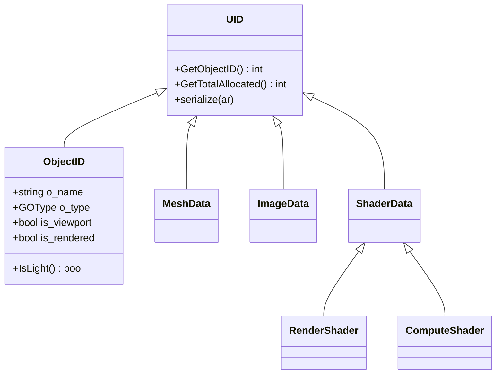

# UID and Resources

`UID` is the generic unique-identifier primitive at the base of every identity-tracked object, and `ResourceManager` is the single factory and registry that owns every persistent UID object.

## UID (`core/UID.hpp`)

`UID` provides globally unique logical resource IDs:

- IDs are sequential and allocated from a static counter (`s_count`).
- Not thread-safe: IDs should be allocated on the main thread.
- IDs are never reused, even after object destruction.
- Value semantics are deleted - `UID` is non-copyable and non-movable, because identity must not be duplicated or transferred. Objects are held via `shared_ptr`, and every UID-derived type (`ObjectID`, `Camera`, `Mesh`, `Light`, `Environment`, `Sprite`, the debug objects, `Scene`, `MeshData`, `ImageData`, `ShaderData`) repeats the ban so the contract is visible where it is inherited.
- Independent resource duplication goes through the pool: `ResourceManager::Load<T>` constructs a fresh object with a new id and the caller copies the fields it wants (`Editor::DuplicateObject`). A copy or move constructor is never the answer, because every id already handed out - scene references, undo records, GPU caches, the pool's own indexes - would silently name a different object.
- `GetObjectID()` returns the unique integer; `GetTotalAllocated()` returns the total allocation count, including destroyed objects.
- The pool reserves each record key during indexing. Its typed factory passes `RestoredId{key}` to the concrete constructor, so restoring an indexed object leaves the next fresh UID available. Standalone cereal objects store their identity in `o_id`.

`ObjectID` (scene layer) extends `UID` with scene metadata, and data resources such as `MeshData`, `ImageData` and `ShaderData` inherit `UID` directly and serialize themselves, constructed from a UID and registered type name in the `ResourceManager` pool. `ShaderData`'s concrete leaves are the CPU Shader module's `RenderShader` and `ComputeShader`. See [Scene Objects](../scene/objects.md).

A graph clone shares ownership of selected CPU shaders rather than copying
identity-bearing objects. Owned upload payloads carry a shader UID plus copied
GPU input data; they allocate no CPU resource identity. Reuploading the same UID
replaces its renderer cache revision, independently of the resource's stable
logical identity. Ordinary UID copy/move construction and assignment remain
deleted, with no special revision-copy path.

## ObjectID as identity (`scene/ObjectID.hpp`)

`ObjectID : public UID` adds scene-specific metadata:

- `o_name` - display name in the editor UI.
- `o_type` - a `GOType` tag used for runtime type identification without RTTI; see [Scene Objects](../scene/objects.md).
- `is_viewport` / `is_rendered` - visibility flags for editor display and the render pipeline, set together by `SetVisible(v, r)`.
- `IsLight()` - true for `GO_LIGHT` and `GO_POLYLIGHT`, the two types that project into the light SSBO. It is a member rather than a predicate repeated in each caller, so the second answer is never forgotten.
- Polymorphic accessors `GetShader()`, `GetShaderUnit(int)`, `GetTransform()` and `GetMaterial()`, all returning `nullptr` by default and overridden by the classes that own those components. `GetShader()` returns the typed `ShaderData*` and `GetShaderUnit(int)` returns `const ShaderUnit*`; a `Mesh` overrides both.

`ObjectID::serialize` keeps the `base_class<UID>` hook strict but reads its own metadata fields through `archive::Optional` - the concrete default constructor already sets `o_type` and `o_name`, so a field a file lacks keeps the right value.

## ResourceManager (`asset/ResourceManager.hpp`)

`ResourceManager` is the single factory and registry for UID-derived objects (scene objects via `ObjectID`, data resources such as `MeshData` / `ImageData` / `ShaderData`). It is:

- App-scoped: owned by the Editor, and cleared on project new/open so no stale object leaks into a save.
- Type-erased: it holds `shared_ptr<UID>` and knows no concrete type.
- The owner of the whole pool's polymorphic serialization.

Design:

- `UID` is the only resource base. Every pooled object derives from it and serializes its own fields under its pool key; there is no reload-hook interface, because each object's `serialize(load)` restores its own state.
- `Load<T>(args...)` constructs and registers in one step, returning a typed `shared_ptr<T>`. It `static_assert`s that `T` derives from `UID`, and - when `T` has a public `o_name` - registers that name and mirrors the unique result back into `o_name` (see [Resource names](#resource-names)).
- `Register(shared_ptr<UID>)` registers an already-constructed object (tests, legacy paths).
- `RegisterDeferred` reserves a UID and records the concrete type and a loader. Project persistence supplies the loader and owns the interpretation of its serialized record.
- `Contains` and `Size` include deferred entries. The first `Get(id)` runs the loader on the main thread, validates the returned object's UID and concrete type, and caches the shared pointer. Recursive requests can load dependencies. A loader exception clears the in-progress flag so the lookup can be retried. If project persistence rejects a record and returns null, the pool drops its UID and name. `Get<T>` casts the result and name lookup uses the same cache.
- `ForEach<T>(fn)` visits every pooled object whose **exact dynamic type** is `T`; this is how UID-keyed GPU caches follow the pool rather than the scene (pooled objects stay referenced by undo history after deletion). It is not a base-class walk: once a base instance (`ObjectID`, `UID`) is itself pooled, the per-type index holds only that instance and derived types are skipped. Base-class enumeration uses `ForEachUID(fn)` plus a cast. Neither callback may `Load` / `Register` / `Remove` / `Clear`, because mutating the pool during iteration invalidates the walk.
- `Remove(int)` and `Clear()` mutate the pool; `Size()` reports its size.
- `SetName(id, name)` / `GetByName(...)` own the display-name registry; names are unique per concrete dynamic type and are derived state, never serialized (see [Resource names](#resource-names)).
- Direct cereal loading constructs the full pool. Saving through either entry point writes live objects and retained records into the same archive. Project open rebuilds the type and name indexes from the records before restoring scene membership.
- Not thread-safe: main thread only.

Two rules keep the pool decoupled:

- The scene holds typed maps of its members. During project open, `SceneComponent` looks up their UIDs and restores the maps, camera and selection.
- No UID object knows the `ResourceManager`, and no UID object constructs another UID object internally - construction happens through `Load<T>`.

Scene membership is stored as UID references, so project open must index the pool before reading the scene. See [Serialization](serialization.md) and [Project Serialization](../asset/project-serialization.md).

## Resource names

Display names are owned by the registry, not by `UID` or the scene. Every lookup
key lives in `ResourceManager`; `ObjectID::o_name` is the serialized display
string that the editor mirrors from it.

- `SetName(int id, const std::string& name)` registers or renames a resource and returns the unique name. `GetByName<T>(name)` and `GetByName(type_index, name)` resolve a name to a pooled object.
- Names are unique per concrete dynamic type, not across the pool: a `Mesh` and a `Camera` may both be called `Ground`. A collision gets the lowest free zero-padded suffix - `Ground`, `Ground.001`, `Ground.002`, ... - and an empty request becomes `Object`.
- Renaming a resource to the name it already owns is a no-op. `SetName` returns an empty string when the id is not pooled, and `GetByName<T>` requires the name to belong to a `T`.
- Removing a resource frees its name, so a later resource can reuse it.
- Names are derived state and are never serialized. On project open, the reader indexes serialized names in ascending UID order and applies the unique name when it constructs the object, so duplicate names are disambiguated deterministically and a re-save preserves them. Creation paths need no extra step: `ResourceManager::Load<T>` registers a scene object's constructor name and mirrors the unique result, so every creation path seeds automatically.
- The registry name is authoritative for lookup; `o_name` is what the UI shows and what a project file stores. Any editor rename path must mirror the returned unique name back into `o_name`; `Load<T>` and `ResourceComponent::Load` write the returned name back themselves. Writing `o_name` directly changes the display string but not the lookup key.
- `"ViewportCamera"` is reserved by the editor for its pooled viewport camera: `EditorViewport::EnsureCamera` loads the camera (which registers `"Camera"`) and immediately renames it, so the viewport camera can never claim the document camera's `"Camera"` name on a reopen. The viewport camera is not scene content, so it never appears in `Scene::cam_list`.

`Scene` keeps no name index: registration and removal maintain the typed pools and `obj_list`. See [Scene Objects](../scene/objects.md).

## Resource<T> and ResPool (`scene/Scene.hpp`)

The Scene's typed containers are defined in the scene layer:

- `Scene::Resource<Object>` is an alias for `ResourceRef<Object>`.
- `Scene::ResPool<Object>` is `std::unordered_map<int, Resource<Object>>`, mapping a UID to its shared pointer for O(1) lookup and removal.

Each object category has a dedicated `ResPool` (`cam_list`, `mesh_list`, and so on), and a master `obj_list` holds all `ObjectID` instances for global lookup. Objects are owned via `shared_ptr`, so removing from a map destroys an object only when no other reference exists. See [Scene Objects](../scene/objects.md).

## IResourceLookup (`core/IResourceLookup.hpp`)

`IResourceLookup` is the fetch/lookup plus name-registry surface over a UID-keyed pool:

- `Get(int)` returns the untyped base (or `nullptr`), `Contains(int)` tests membership, and `Get<T>(int)` is the typed lookup.
- `GetByName(...)` resolves a registered name within one concrete type, and `SetName(...)` registers or renames a resource; these are the registry operations described in [Resource names](#resource-names).
- `ForEachUID(fn)` enumerates the whole pool; `ForEach<T>(fn)` enumerates one exact dynamic type. Base-class enumeration therefore goes through `ForEachUID` plus a cast.
- Controllers depend on this narrow interface instead of the concrete `ResourceManager`: they can fetch pooled objects by integer id, enumerate them and register names, but cannot mutate the pool (no `Load` / `Register` / `Remove` / `Clear`) or drive its serialization. This mirrors `IOperationSink`, keeping the dependency inverted.
- Objects are fetched as `shared_ptr` because the pool owns them; a handler typically derives a raw pointer from the temporary `shared_ptr` and uses it within the handler scope. The pool keeps pooled objects alive, so id-based lookup never dangles.

`ResourceManager` implements `IResourceLookup`.

## Identity across save and load

Selection is held at runtime as `const ObjectID*` pointers but written as UIDs (`selectedUids` plus `activeUid`), mirroring `SelectionState`. The pointer-to-UID conversion lives in the scene-layer free functions `neurus::SnapshotSelectionUids` / `RestoreSelectionUids` (in `Scene.hpp`), shared by the scene project component and the editor's selection snapshot/restore. On load the UIDs are resolved back to pointers via `Scene::GetObjectID()` after restoring scene membership. Keeping this in the scene layer (which owns the pointer-to-UID mapping) means the editor depends downward only.

## Resource type registration

The pool stores `shared_ptr<UID>`. Each registered concrete type provides a factory for restoring its own fields.

- Each pooled type uses `NEURUS_REGISTER_RESOURCE_TYPE` in its owning registration translation unit. Registration binds the archive name to the C++ type, its field writer and its `RestoredId` factory.
- Scene types: `scene/registrations/TypeRegistration.cpp` registers the `UID` and `ObjectID` bases and every derived scene type, with factories for pool records and cereal polymorphic relations for standalone pointers.
- Data resources: `asset/registrations/DataRegistration.cpp` registers `MeshData`, `ImageData` and `RenderGraphData`. The shader module registers `ComputeShader` and `RenderShader`.

The registrations live in `.cpp` translation units, so static-library builds would dead-strip them unless a symbol is odr-used. The force-init headers `scene/registrations/TypeRegistration.hpp` and `asset/registrations/DataRegistration.hpp` (each a `CEREAL_FORCE_DYNAMIC_INIT`) must be included at every serialization site that touches the pool. See [Serialization](serialization.md).
