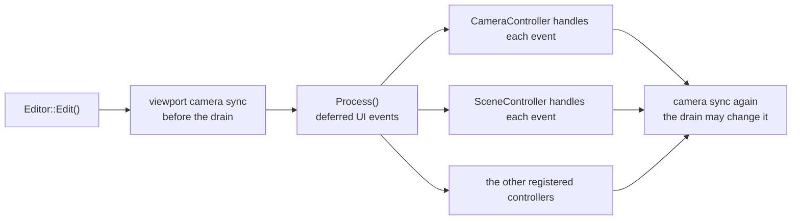

# Controllers

Controllers are the Editor's event-driven reaction layer: each one subscribes to
typed events in `Init()` and mutates state in its handlers, with no per-frame
polling.

## Controller design constraints

- **Keep controllers as stateless as possible.** Use local variables for a discrete request. The document owns the live value and the operation owns the values needed for undo. Keep a controller member only when the interaction itself spans events, such as a drag whose begin and end events delimit one gesture.
- **Keep the header light.** Declare the controller interface and include only what those declarations require. Forward-declare types used through pointers or references. Keep a controller’s handlers and private helpers in its implementation file. Extract a shared helper when multiple controllers use the same behavior.
- **Respect the controller's knowledge boundary.** Handle typed requests through `ControllerContext`. The same graph request can come from the UI, a command or a script. `ScriptController` translates script boundaries into operation scopes. `OperationManager` owns grouping and replay. The Editor publishes render requests and the renderer owns GPU allocation and execution.
- **Submit history after the edit.** A handler receives a typed request, changes the CPU document, then passes the reversible description to `ctx.ops.Submit`. The operation manager owns the recording buffer, creates `OperationContext`, and calls `Operation::Apply` for undo, redo, or rollback.
- **Return results on the request.** For synchronous mutations that can fail, give the event a caller-owned reply slot for the result or diagnostic, as `ShaderCreateRequested` does. Fill it before `Emit` returns. The caller owns presentation or exception translation. Keep deferred validation errors on the scope-completion reply.

## The event-driven pattern

Controllers receive discrete events rather than polling. Only the UI boundary is
deferred: `Editor::Edit()` drains the events a panel signal queued in the previous
frame. Everything else - a controller reaction, a script write, an operation
replay - goes through `Emit`, which runs the handlers before it returns:



Outside the drain, `ctx.events.Emit(PositionChanged{...})` is synchronous and may be
called anywhere in the editor: `ObjectController::OnPositionChanged` runs before
`Emit` returns.

Input translation (mouse events to camera events) is handled in
`Editor::Initialize()` via `MouseMoveEvent`/`MouseScrollEvent` subscriptions, so
`Edit()` is two viewport-camera syncs around one `EventQueue::Process()` call.

## The base class

```cpp
class Controllers
{
public:
    virtual ~Controllers() = default;
    virtual void Init(ControllerContext& ctx) = 0;
};
```

- `Init(ControllerContext& ctx)` receives the controller context (event dispatch,
  pooled-object lookup, operation sink, scene/config providers).
- Derived classes subscribe to typed events in `Init()` (for example,
  `ctx.events.Subscribe<CameraZoomEvent>()`).
- Handlers emit through `ctx.events.Emit(...)`, which is synchronous: the event a
  handler emits is fully handled before the handler resumes.
- Stored via `std::unique_ptr<Controllers>` in the Editor's controller list.

## ControllerContext

`ControllerContext` (`src/editor/controllers/ControllerContext.hpp`) is the only
thing a controller depends on. It bundles the three controller-facing interfaces:

- `IEventQueue& events` for `Subscribe` and synchronous `Emit`
- `IResourceLookup& resources` for pooled-object lookup by id
- `IOperationSink& ops` for recording undoable operations, including the
  `BeginScriptScope` / `EndScriptScope` pair that compacts one script run into
  one entry

plus providers for the Editor-owned singletons that are not pooled UID objects:

- `scene`: the current Scene, re-queried per use because New/Load swaps it
- `config`: the live `RenderConfig`, mutable
- `viewport`: the viewport composition root, mutable

There is one handle per Editor-owned thing, and the viewport is one thing: the
modal transform state is `viewport()->Gizmo()`, not a `gizmo` provider of its
own, because a second provider is a second name for the same object and free to
be wired to a different one.

The viewport handle is mutable only so that `Gizmo()` is reachable; its own
mutators (extent, camera, cursor, overlay dirty flags) stay the Editor's
per-frame job by documented contract, not by a `const` that had to be routed
around. A read-only handler should still bind `const EditorViewport*` locally,
since every query it needs is const.

The Editor owns the context for the lifetime of the subscriptions. Handlers may
capture it by reference or capture its interface handles by value. Resolve the
current scene and other replaceable resources inside each handler.

## Registration

```cpp
template<typename T>
void Editor::RegisterController()
{
    auto ctrl = std::make_unique<T>();
    ctrl->Init(ed_ctx);
    ed_controllers.push_back(std::move(ctrl));
}
```

The context carries everything a controller needs (event dispatch, pool lookup,
operation sink, scene, and render config), so every controller - including
`SceneController`, `ObjectController`, `ScriptController` and
`RenderConfigController` - is registered uniformly through
`RegisterController<T>()`; no providers are constructed manually. Controllers are
event-driven, so no per-frame polling is required.

Registration order matters where two subscribers handle the same event: handlers
run in registration order, and because dispatch is synchronous they also run in
that order within one call. That is why `SceneController`, registered with the
controllers, removes objects before the Editor's own `SceneObjectDeleteRequested`
subscription re-syncs the viewport camera. Where subscribers share no event type,
order is free: `ObjectController` and `SceneController` never see the same event,
and neither does the gizmo with `CameraController` - the gizmo takes
`MouseMoveEvent` and reads the cursor from `e.position`, while `CameraController`
takes the `Camera*` events the Editor derives from it.

## Mutation notification

`neurus::notify` (`src/editor/controllers/MutationNotify.hpp`) is the single answer
to "what does a scene mutation imply?", shared by every controller. Mutating a
scene object is never just the write: something has to reset temporal
accumulation, something has to refresh the light SSBO the write did not touch,
and something has to mark the project unsaved. Which of those apply is a function
of two things only, the object's type and whether the edit is final, so it is
answered here once instead of at each mutation site.

Two tiers:

- `ObjectMutated(obj, events)` is committed (a panel edit, an add, a confirmed
  gesture) and emits `LightingRebuild` for a light, plus `SceneModified` and
  `RenderResetEvent`.
- `ObjectPreviewed(obj, events)` is transient (one frame of a live drag) and
  emits the cheap `LightGpuChanged` for a light, plus `RenderResetEvent`, and
  deliberately no `SceneModified`, because that flag is one-way: nothing
  un-dirties a project, so a cancelled gesture that had emitted it would leave the
  document needing a save for a change that no longer exists.

The tier asymmetry in light work is deliberate, not an oversight: a preview runs
per mouse-move and buys the single-struct update, while a committed edit pays for
the authoritative full-dict rebuild, since `UploadLighting` filters by shader
variant and visibility while walking `light_list`.

`Mutated`/`LightStructChanged`/`LightingRebuilt`/`Repaint` are the primitives the
two tiers compose, for handlers that already know the type (a light's power edit)
or mutate no object at all (a gizmo guide that appeared or vanished). The type
test itself is `ObjectID::IsLight()`, a member because two of the ten GOTypes
answer yes and every copy of the test is a place to forget the second one.

Scope: this is mutation policy, not a general event facade. A camera orbit and a
render-setting change mutate no scene object and have no tier, so they emit
`RenderResetEvent` directly.

## CameraController

`src/editor/controllers/CameraController.hpp/cpp` owns event-driven camera
manipulation (orbit/zoom/dolly/pan) via `CameraEvents`.

```cpp
void CameraController::Init(ControllerContext& ctx)
{
    // Gesture boundaries: capture the "before" pose on begin, record one op on end.
    ctx.events.Subscribe<CameraDragBegin>([this, ctx](const CameraDragBegin& e) { /* capture */ });
    ctx.events.Subscribe<CameraDragEnd>([this, ctx](const CameraDragEnd& e) { /* record */ });

    ctx.events.Subscribe<CameraRotateEvent>([ctx](const CameraRotateEvent& e) { OnCameraRotate(e, ctx); });
    ctx.events.Subscribe<CameraPushEvent>([ctx](const CameraPushEvent& e) { OnCameraPush(e, ctx); });
    ctx.events.Subscribe<CameraSlideEvent>([ctx](const CameraSlideEvent& e) { OnCameraSlide(e, ctx); });
    ctx.events.Subscribe<CameraZoomEvent>([ctx](const CameraZoomEvent& e) { OnCameraZoom(e, ctx); });
    ctx.events.Subscribe<CameraResizeEvent>([ctx](const CameraResizeEvent& e) { OnCameraResize(e, ctx); });
}
```

Design:

- Event-driven: no per-frame `Update()` polling needed.
- Receives discrete camera events (rotate, zoom, push, slide) from the Editor.
- Each event carries the camera's integer UID (`camId`) plus a delta magnitude;
  the handler resolves it through `ResolveCamera`. `ResolveCamera` resolves
  against the resource pool, not `cam_list`, so the viewport camera (pooled,
  never scene content) is manipulated by the same events as any scene camera.
- Does not own the camera; resolves it by UID per event.

`CameraController::OnCameraResize` resizes whichever camera a
`CameraResizeEvent` names, resolved through the pool. The Editor emits it for the
active camera on a viewport resize and on a camera handoff (activation,
deactivation, load), so a camera restored on a different window size (or never
framed) gets the current aspect once. The controller never needs to know whether
that UID is a scene camera or the viewport camera.

## SceneController

`src/editor/controllers/SceneController.hpp/cpp` owns the scene **document**:
selection, scene membership (add/delete) and camera activation. Object property
writes belong to `ObjectController`.

```cpp
void SceneController::Init(ControllerContext& ctx)
{
    // Selection
    ctx.events.Subscribe<ObjectSelected>(...);
    ctx.events.Subscribe<ObjectDeselected>(...);
    ctx.events.Subscribe<SelectionChanged>(...);
    // Active camera (scene state, independent of selection)
    ctx.events.Subscribe<ActiveCameraChanged>(...);
    // Membership
    ctx.events.Subscribe<SceneObjectAddRequested>(...);
    ctx.events.Subscribe<SceneObjectDeleteRequested>(...);
    ctx.events.Subscribe<DeleteObjectsRequested>(...);
}
```

Seven subscriptions in total; each forwards to a free-function handler.

Design:

- Stateless: all handlers are free functions in an anonymous namespace.
- Events carry `int objectUid`; handlers resolve it against the current Scene
  (typed pool lookup, for example `mesh_list.find(objectUid)`) through the
  context's scene provider and mutate the document directly. The add handler also
  fetches the pooled object by UID, because the pool owns the resource.
- Scene-owned state (selection, membership, active camera) is reached through the
  context's scene provider; events never carry the scene.
- Most mutating handlers finish with a `neurus::notify` call rather than their own
  `Emit`s, so the `EditorEvents` they emit (`SceneModified`, `LightingRebuild`,
  `RenderResetEvent`) cannot drift from the gizmo's. The add handler also emits
  its own follow-up event: it asks for the GPU upload before it submits its
  composite. Camera activation records the op and mutates only the Scene; the
  Editor republishes the active camera after the dispatch and emits the
  `CameraResizeEvent` that frames it for the viewport.
- GPU uploads are delegated to the Editor via `EditorEvents`
  (`LightGpuChanged`, `LightingRebuild`, `SceneModified`, `RenderResetEvent`,
  `SceneObjectGpuUploadRequested`), which the Editor subscribes to and turns into
  `RenderRequest` values posted to the `DeferredRenderer`; the renderer executes
  them at its per-frame drain.

### Import/Add split and the delete path

`Editor::OnMeshImport`/`OnCameraAdd`/`OnLightAdd`/... only load the resource into
the pool and forward the object UID via `SceneObjectAddRequested`. The
`SceneController` fetches the pooled object by UID, registers it, selects it, and
records `CompositeOp[SceneObjectAddOp({u},true), SetSelectionOp(...)]`.

The Delete gesture (`DeleteObjectsRequested`) is forward-only and carries an
explicit UID list. The Editor subscribes to the UI's `DeleteRequested` intent and
stamps it with the current selection's UIDs; a CLI or script command emits it
directly. The `SceneController` removes exactly the listed objects through one
batched `SceneObjectDeleteRequested`, so the batched handler is the single
removal path shared with replay (no replay-only handling), and records
`CompositeOp[SetSelectionOp(before->after), SceneObjectAddOp(uids,false)]` (delete
of N is one op; the selection entry is skipped when nothing changed, and it is
first so undo restores the exact pre-delete selection after the objects come
back). The emit deliberately precedes the submit: the removal runs synchronously
inside it, while `SceneObjectAddOp` stores only a UID list and a direction, so
the later submit reads no state the removal invalidated.

Content creation (`MeshImportRequested`, `CameraAddRequested`,
`ObjectDuplicateRequested`) also lands in the Editor, which owns the pool: it
creates the object and fills the emitter's borrowed `ObjectCreateResult` reply
slot during the synchronous dispatch. A null slot means the outcome is only
logged. The script layer uses these instead of calling the Editor.

Light membership changes emit `LightingRebuild` (the SSBO is a scene projection).
GPU caches (`MeshGPU`, shadow maps) are scene-scoped: `UploadSceneResources`
uploads only objects present at load, and an object entering the scene (live add
or undo/redo replay) or a light whose shadow was just enabled emits
`SceneObjectGpuUploadRequested`, which the Editor resolves with an on-demand
upload (skip-if-cached).

### Pure-intent wrapping

The Editor subscribes to the UI's `ObjectClicked` and `DeleteRequested` intents
and stamps the dedicated scene events `ObjectSelected{ objectUid, modifiers }`
and `DeleteObjectsRequested{ uids }` (the two wrap subscriptions in
`Editor::Initialize`). Panels never stamp the scene.

## ObjectController

`src/editor/controllers/ObjectController.hpp/cpp` owns **every object property
write**: visibility, transforms, and the camera / mesh / light / environment /
debug knobs. That is 26 subscriptions; see `SceneEvents.hpp` for the structs.

```cpp
void ObjectController::Init(ControllerContext& ctx)
{
    // Visibility, position/rotation/scale, camera target/fov/pose,
    // mesh shadow/material, light power/color/radius/shadow/cutoff,
    // environment intensity/rotation, and every Debug*Changed knob.
    ctx.events.Subscribe<PositionChanged>([ctx](const PositionChanged& e) { OnPositionChanged(e, ctx); });
    // ... one Subscribe per property event
}
```

Design:

- Resolution goes through `IResourceLookup`, never the scene. Writability is a
  property of the pool, not of scene membership, so a pooled object that is not in
  the document - an object held by undo history, or the pooled viewport camera -
  is editable. That is also what lets a script write to an object it holds before
  the object enters the scene.
- It never reads the scene: `test/editor/test_object_controller.cpp` hands it a
  scene provider that calls `ADD_FAILURE()`, so a regression cannot pass silently.
- Stateless: free functions in an anonymous namespace. Most handlers capture the
  before value, mutate through the pool, submit one forward operation through
  `ctx.ops`, and route the consequences through `neurus::notify`.
  `OnCameraPoseChanged` follows the same shape: an absolute pose write applies
  the pose and records a `CameraTransformOp`, and the replay of that op re-enters
  the handler with `Submit` suppressed by the phase guard.
- Debug property handlers go through one `ForDebugObject(resources, uid, fn)`
  helper that probes the `DebugLine`, `DebugPoints` and `DebugMesh` pools in turn
  and invokes a generic lambda on the first hit. The three classes share
  `ObjectID` and `Transform3D`, but no shared base declares color, opacity or
  x-ray, so the lambda is `auto&` and the three pool lookups stay in one place.
  It returns whether a pool held the UID, so an unknown UID mutates nothing,
  records nothing, and skips `Mutated()`. Each handler captures the before value
  inside the lambda and submits its `TransitionOp` there, so undo is per-property.
- Camera target edits fold into the coupled `CameraTransformOp` (position
  unchanged) so a panel target edit and a viewport drag share one undoable
  "Camera Transform"; FOV records a `CameraFovOp` of its own, and an absolute
  pose write records a `CameraTransformOp` - both on the live path (a script
  setting `Camera.position`) and on replay.

## ShaderController

`ShaderEvents.hpp` defines two ways to address a stage. The mesh panel sends a mesh UID. Pooled shader requests carry the shader UID directly, including when a script obtains the shader through a pass node.

| Request | Operation and compile behavior |
| --- | --- |
| Mesh panel text edit | `ShaderEditBegin` captures the initial text. `ShaderCodeEdited` updates the draft. `ShaderEditEnd` records one `SetShaderCodeOp` if the text changed. The panel's Compile action compiles the draft. |
| Mesh panel structure edit | Changing an element records `SetShaderFieldOp`. Adding an element records `AddShaderFieldOp`. Both use the panel's explicit Compile action. |
| Pooled stage code or structure edit | `ShaderUnitCodeSet` and `ShaderUnitStructSet` resolve the shader UID and stage. A pass-referenced shader records `SetPassShaderStageOp` and compiles automatically at the next graph read or when the request or group completes. Other pooled shaders record their code or structure operation and compile on request. |

Only the mesh text gesture needs controller state between events. On history replay, a pass-stage operation restores the stage and reconciles renamed sockets before the next connection operation runs. A saved project rebuilds the stage bytecode from the stored source.

Mesh shader creation goes through the Editor's `ShaderCreateRequested` handler. It compiles and pools the shader, then sends `ObjectShaderAddRequested` to `SceneController`, which assigns the mesh reference and records `ShaderReplaceOp`. Synchronous creation and compile requests can return diagnostics through their caller-owned result slots.

## RenderConfigController

`RenderConfigController` is the single mutation path for the Editor-owned
`RenderConfig`, reached through the `ControllerContext`'s `config` provider so it
never includes Editor internals (registered uniformly via
`RegisterController<T>`). `ConfigEditBegin` captures the config,
`RenderConfigChangedEvent` applies live, and `ConfigEditEnd` records one
`SetRenderConfigOp`. Discrete edits (checkbox/combo) arrive without a gesture and
record immediately. No-op writes (`before == after`, via `RenderConfig`'s
defaulted `operator==`) are never recorded. `SetRenderConfigOp` is scene-level
(not UID-based) and deliberately non-mergeable (empty `MergeKey`).

## RenderGraphController

A topology request describes one user edit. Renaming a node records the old and new names. Connecting an occupied input or scene output emits one `GraphProducerChanged` event. The controller records a composite with two children that unlink the previous producer and link the new one. One undo restores the previous connection. Reconnecting the same producer leaves history untouched.

The graph controller also handles assigning a pooled shader to a node. `ShaderController` handles edits to the shader's code or structure, addressed by shader UID and stage. Both controllers submit history describing the change they have already made. The operation system requests validation and publication at the appropriate boundary. A standalone request validates before publishing. A script can temporarily disconnect a required input and reconnect it within the same operation scope. The scope validates the final graph and publishes the accepted changes together.

See [Editing the render graph](../script/overview.md#editing-the-render-graph) for examples.

## ScriptController

`ScriptController` is the stateless bridge between a script run and the operation
sink. It forwards run boundaries and returns any final validation error through the completion event.

The start event carries the history label the host chose - "Run Script" for a console run,
"Run <file>.py" for a file run.

`ScriptEngineImpl::RunSource` emits `ScriptRunStarted` before it executes the
source and `ScriptRunFinished` on every exit path, so a raising run still closes
its scope. The scope itself is the operation manager's; see
[Operations](operations.md#one-undo-step-per-script-run).

## TransformGizmoController

`TransformGizmoController` owns the event-driven modal transform via
`GizmoEvents` (arm, constrain, drag, confirm, cancel). It owns nothing and calls
exactly one `TransformGizmo` method per event; it shares no event type with
`CameraController`, and it reads the drag cursor from the event's `position`
rather than from the viewport, so its registration order next to
`CameraController` has no dispatch consequence. The drag writes `Transform3D`
directly and submits nothing; confirm submits exactly one
`SetPositionOp`/`SetRotationOp`/`SetScaleOp` for the whole gesture. Because the
ops are not what notifies, the controller notifies
itself through the shared `neurus::notify` tiers above, never its own `Emit`s:
every drag frame (and the cancel path, which restores the snapshot) is
`ObjectPreviewed`, a confirm is `ObjectMutated`, and a guide that merely appeared
or vanished is `Repaint`. That is what makes a whole G-drag-Esc round trip leave
no trace, and `test/editor/test_transform_gizmo_controller.cpp` pins it (the
tiers are invisible in a screenshot and wrong only much later). For the state
machine and guide geometry, see [Transform gizmo](gizmo.md).

## Producing operations

The operation model, coalescing strategies, and history persistence are
documented in [Operations](operations.md). This section covers only how the
controllers produce operations.

Three controllers use the explicit begin/end gesture pattern (capture "before" on
a begin event, mutate live without recording, record one op on the end event):

- `CameraController`: `CameraDragBegin` captures the pose,
  `CameraRotate`/`CameraPush`/`CameraSlide` mutate live, `CameraDragEnd` records
  one `CameraTransformOp` (no-op if the pose is unchanged). `CameraTransformOp` is
  deliberately non-mergeable (empty `MergeKey`) so each drag is its own undo
  entry. Scroll zoom has no press/release boundary, so it stays on the
  implicit-merge path via the separate `CameraZoomOp` type (mergeable, keyed
  `camera_zoom:<uid>`). Two op types instead of one boolean flag: the gesture
  boundary vs. burst coalescing are distinct behaviors that belong to distinct
  ops.
- `RenderConfigController`: described above.
- `ShaderController` uses the mesh panel's gesture and element operations and the
  pooled stage operations described [above](#shadercontroller).

Every controller records through `ctx.ops.Submit`, whether the edit came from a
panel, a gesture or a script. While a script run is open, `OperationManager`
buffers those submits instead of pushing them, so the whole run lands as one
`CompositeOp`; see
[Operations](operations.md#one-undo-step-per-script-run).
