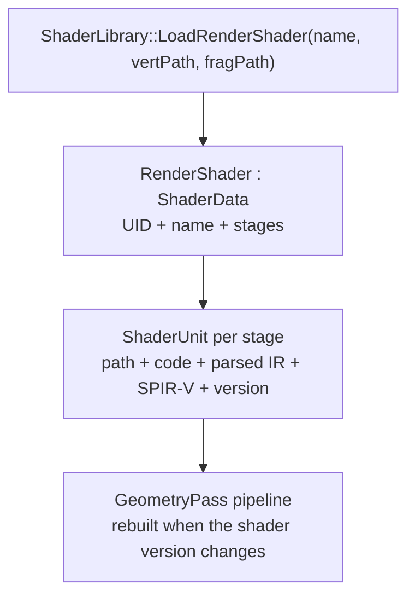

# Shaders

Per-mesh shaders are editable at runtime through the Shader Editor panel or a
Python script. The CPU-side data lives in the asset layer; the renderer owns the
parse/generate/compile pipeline and every GPU resource below it.

## Data model

```
src/asset/data/shader/
    ShaderStage.h             ShaderType + ShaderTypeFromPath + default paths
    ShaderStruct.h/.cpp       parsed GLSL IR
    ShaderStructSerialize.h   cereal overloads for the IR
    ShaderUnit.h              path, code, parsed IR, SPIR-V, version
    ShaderData.h/.cpp         UID bundle: name + one ShaderUnit per stage

src/render/shaders/
    RenderShader.h/.cpp       ShaderData + vertex/fragment parse/generate
    ComputeShader.h/.cpp      ShaderData + compute parse/generate
    ShaderParser, ShaderGenerator, ShaderCompiler, ShaderLibrary
```

`ShaderData` is the pooled identity. A `ShaderUnit` is one stage inside it and
is never pooled on its own. `RenderShader` and `ComputeShader` are the concrete
leaves: the former is the vertex+fragment bundle used by a mesh, the latter is a
single compute bundle.



## Edit flow

The panel path is mesh-keyed: the ShaderEditorPanel emits `ShaderEvents`
(`ShaderCodeEdited`, `ShaderStructEdited`, `ShaderFieldAdded`), and the
`ShaderController` mutates the mesh's shader data. Shader creation is
Editor-owned; compilation is handled by `ShaderController`. Create and compile
bump the version, while code and struct edits wait for an explicit Compile.

The script path is shader-keyed, so it also reaches a pooled `ComputeShader`:

- `mesh.shader` is a slot: `create(...)` / `remove()` / `attached`, plus
  `vertex` and `fragment` unit views.
- `neurus.shader.load_shader(path, name="")` pools a `RenderShader` (`.vert`
  or `.frag`, with the missing side from the default G-buffer pair) or a
  `ComputeShader` (`.comp`). `.geom` is rejected.
- `neurus.data.shaders` lists every pooled shader by UID or registered name.
- A `ShaderUnit` view exposes `code`, `parsed` and `compile()`. Reading
  `parsed` returns a copy; mutating it and assigning it back writes the whole
  IR through one `ShaderUnitStructSet` event and one undo op.
- `ShaderUnitCodeSet`, `ShaderUnitStructSet` and `ShaderUnitCompileRequested`
  are resolved by `ShaderData` UID in `ShaderController`. A script run remains
  one undo entry.

Compile resets temporal shadow accumulation. Both compile paths emit
`RenderResetEvent`: the panel handler does it in its subscription wrapper after
`OnCompileShader`, and the shader-keyed handler emits it on success. A mesh
shader also emits `ShaderCompiled`, so the Editor warms its pipeline; a
standalone compute shader does not.

## Persistence

`ShaderData` serializes its name; the concrete leaf serializes the stage map
(`path`/`code`/`parsed` per stage) after its own paths. `RenderShader` adds its
two source paths; `ComputeShader` adds its source path and default-uniform
entries. SPIR-V and versions are runtime state and are rebuilt on load.

A stage with restored code keeps it; a legacy path-only shader (no `stages`
key) re-parses from disk. Pooled shader names are re-seeded after a project
load, so `neurus.data.shaders["Name"]` still resolves.

Replacing a mesh shader keeps the previous pooled shader so its
`ShaderReplaceOp` can undo the relink. The pool is cleared on project new/open;
a history-aware prune for long live-coding sessions is tracked separately
(issue #72).

## Overlay shaders

The debug and gizmo overlay passes share the `overlay_line` / `overlay_point`
shader pair, and the wireframe uses `debug_wire.frag`. Their behavior is
described in the Debug overlay and Gizmo pass sections of [Passes](passes.md).
