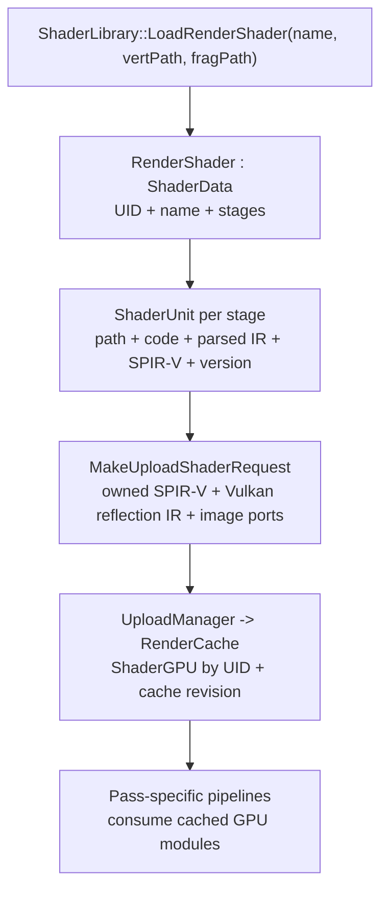

# Shaders

Per-mesh shaders are editable at runtime through the Shader Editor panel or a
Python script. Asset owns passive shader data and source-file IO; the dedicated
CPU Shader module owns parsing, generation, compilation and the high-level
shader bundles. The renderer owns Vulkan shader modules, GPU pipelines and their
descriptor resources.

## Data model

```
src/asset/data/
    ShaderData.hpp/.cpp         UID bundle, stage values and source text IO
    shader/
        ShaderStage.hpp         ShaderType + ShaderTypeFromPath + default paths
        ShaderStruct.hpp/.cpp   parsed GLSL IR
        ShaderStructSerialize.hpp  cereal overloads for the IR
        ShaderUnit.hpp          path, code, parsed IR, SPIR-V, version

src/shader/
    RenderShader.hpp/.cpp       ShaderData + vertex/fragment parse/generate
    ComputeShader.hpp/.cpp      ShaderData + compute parse/generate
    ShaderParser, ShaderGenerator, ShaderCompiler, ShaderLibrary
    BuiltInRenderData.hpp/.cpp  compiled defaults, port catalog and fallback graph
    registrations/
        ShaderRegistration.hpp/.cpp  pooled shader cereal registration
```

`ShaderData` is the pooled identity. A `ShaderUnit` is one stage inside it and
is never pooled on its own. `RenderShader` and `ComputeShader` are the concrete
leaves: the former is the vertex+fragment bundle used by a mesh, the latter is a
single compute bundle. Their behavior belongs to `neurus_shader`, while the
base data and IR remain in `neurus_asset_data`. Asset data and project persistence
do not depend on Shader tooling.

`ShaderData` owns source text loading and path resolution. Reading raw text does
not overwrite editable/generated stage code or trigger compilation. Shader tooling
consumes source text; existing file-loading convenience methods remain
compatibility facades that delegate IO to Asset.

Authoring graph nodes own pooled shaders through `PassShaderRef`;
the Editor retains mutable access to the originals. Publication clones topology
and shares those references. The render thread reads only their stable shader
UIDs, never mutable source, parsed IR, bytecode or version fields. Ordinary UID
copy/move stays deleted; no shader data clones or secondary identities are needed.

`MakeUploadShaderRequest` copies shader identity, stage SPIR-V and the metadata
needed to reflect Vulkan descriptors and push constants. It also derives owned
image ports with the Vulkan-free `ExtractPassPorts`, which `BuiltInRenderData`
uses to build the default pass contracts. Uploads execute before
`CompileRenderGraphRequest{graph}` in FIFO order. `UploadManager` constructs
`ShaderGPU` with the uploaded ports, and `RenderCache` owns and indexes it. Passes
consume cached GPU modules and own their pass-specific pipelines. The graph
uploader checks custom shaders against the built-in contracts before mapping
the runtime graph.

A same-UID upload changes the GPU cache revision and refreshes dependent
passes/graphs even when topology is unchanged. Resource references and frame
fences preserve earlier GPU resources until their submitted work completes.
Built-in recipes follow the same CPU preparation, uploader, cache and pass path;
null selection does not insert default shaders into the project pool.



## Edit flow

Creation follows the mesh-import split. The UI emits `ShaderCreateEvent` (from
the Create Shader button) and a script emits `ShaderCreateRequested`; both name
a mesh, and each stage side is a source path or a pooled `ShaderData` whose
matching stage is copied; an omitted side uses the default G-buffer source
(`kDefaultVertexPath` / `kDefaultFragmentPath`). The **Editor** creates and
compiles the shader into the pool, then emits
`ObjectShaderAddRequested{mesh, shader}`.
**SceneController** resolves both through the read-only pool, links the mesh
and records one `ShaderReplaceOp`. `ShaderImportRequested` (the script's
`load_shader`) is the pool-only verb: it imports a shader asset and never
touches a mesh. Remove is a SceneController unlink. `ShaderController` owns
content edits and compilation. Create and compile bump the version, while code
and struct edits wait for an explicit Compile.

The panel path is mesh-keyed: the ShaderEditorPanel emits `ShaderEvents`
(`ShaderCodeEdited`, `ShaderStructEdited`, `ShaderFieldAdded`), and
`ShaderController` mutates the mesh's shader data.

The script path is shader-keyed, so it also reaches a pooled `ComputeShader`:

- `mesh.shader` is a slot: `create(...)` / `remove()` / `attached`, plus
  `vertex` and `fragment` unit views.
- `neurus.shader.load_shader(path, name="")` pools a `RenderShader` (`.vert.glsl`
  or `.frag.glsl`, with the missing side from the default G-buffer pair) or a
  `ComputeShader` (`.comp.glsl`). `.geom.glsl` is rejected.
- `neurus.data.shaders` lists every pooled shader by UID or registered name.
- A `ShaderUnit` view exposes `code`, `parsed` and `compile()`. Reading
  `parsed` returns a copy; mutating it and assigning it back writes the whole
  IR through one `ShaderUnitStructSet` event and one undo op.
- `ShaderUnitCodeSet`, `ShaderUnitStructSet` and `ShaderUnitCompileRequested`
  are resolved by `ShaderData` UID in `ShaderController`. A script run remains
  one undo entry.

Compile resets temporal shadow accumulation. Both compile paths emit
`RenderResetEvent`: the panel handler does it in its subscription wrapper after
`OnCompileShader`, and the shader-keyed handler emits it on success. Successful
compilation emits `ShaderCompiled` for both render and compute shaders, so the
Editor uploads changed data before republishing graphs referencing the shader.
Mesh startup and successful compilation use the same owned shader upload path.

## Persistence

`ShaderData` serializes its name; the concrete leaf serializes the stage map
(`path`/`code`/`parsed` per stage) after its own paths. `RenderShader` adds its
two source paths; `ComputeShader` adds its source path and default-uniform
entries. SPIR-V and versions are runtime state and are rebuilt on load.

A stage with restored code keeps it; a legacy path-only shader (no `stages`
key) re-parses from disk. Pooled shader names are re-seeded after a project
load, so `neurus.data.shaders["Name"]` still resolves.

ApplicationCore force-links Shader module registration before project loading.
Asset persistence restores registered resource types through a generic callback;
it does not include concrete shader classes or invoke shader tooling directly.
The existing concrete shader serialization reload/recompile behavior is retained.

`RenderShader::CompileToSpv` also checks the compiled SPIR-V stage interface:
fragment input locations/components must have matching vertex output scalar
types. Compilation or interface failure clears both runtime stage binaries.
Resource loading drops failed shaders and clears consumer references; rendering
uses cached built-ins without registering replacements in the project pool.
The renderer applies the same interface requirements to uploaded stage data
before creating dependent GPU pipelines.

`BuiltInRenderData` uses `ShaderLibrary` to load and compile the recipes in
`PassKinds`, then owns the results directly by recipe name. It builds the port
catalog from those shaders and uses the catalog to construct the fallback graph.
Default and custom scene passes get their GPU shader modules from `RenderCache`.
Pass reuse depends on the selected shader UID and GPU cache revision. Scene
replacement invalidates project shader and pipeline cache entries because
resource UIDs and compile versions can repeat across files.

Replacing a mesh shader keeps the previous pooled shader so its
`ShaderReplaceOp` can undo the relink. The pool is cleared on project new/open;
a history-aware prune for long live-coding sessions is tracked separately
(issue #72).

## Overlay shaders

The debug and gizmo overlay passes share the `overlay_line` / `overlay_point`
shader pair, and the wireframe uses `debug_wire.frag.glsl`. Their behavior is
described in the Debug overlay and Gizmo pass sections of [Passes](passes.md).
