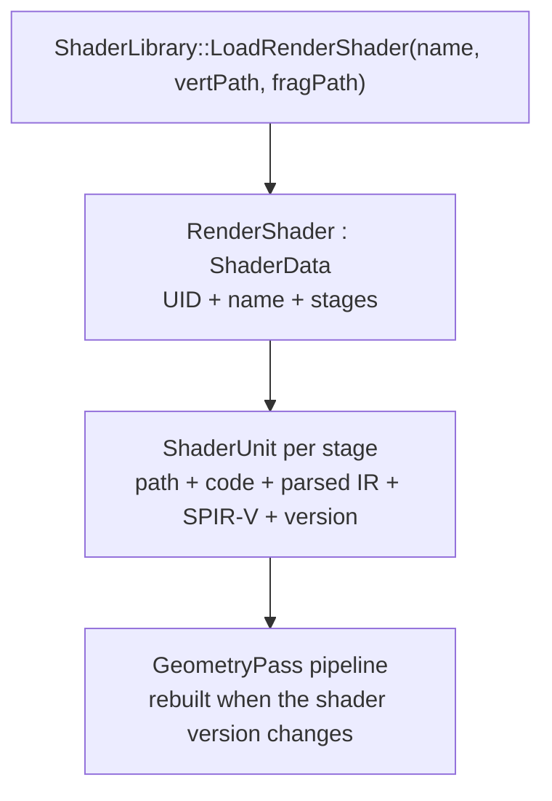

# Shaders

Per-mesh shaders are editable at runtime through the Shader Editor panel or a
Python script. The asset layer owns shader data and the CPU
parse/generate/compile pipeline. The renderer owns shader modules, GPU pipelines
and their descriptor resources.

## Data model

```
src/asset/data/
    ShaderData.hpp/.cpp         UID bundle: name + one ShaderUnit per stage
    shader/
        ShaderStage.hpp         ShaderType + ShaderTypeFromPath + default paths
        ShaderStruct.hpp/.cpp   parsed GLSL IR
        ShaderStructSerialize.hpp  cereal overloads for the IR
        ShaderUnit.hpp          path, code, parsed IR, SPIR-V, version
        RenderShader.hpp/.cpp   ShaderData + vertex/fragment parse/generate
        ComputeShader.hpp/.cpp  ShaderData + compute parse/generate
        ShaderSnapshot.hpp     owned interface metadata and compiled bytecode

src/asset/shader/
    ShaderParser, ShaderGenerator, ShaderCompiler, ShaderLibrary
    ShaderSnapshot.cpp         snapshot construction and CPU reflection

src/asset/registrations/
    ShaderRegistration.hpp/.cpp  pooled shader cereal registration
```

`ShaderData` is the pooled identity. A `ShaderUnit` is one stage inside it and
is never pooled on its own. `RenderShader` and `ComputeShader` are the concrete
leaves: the former is the vertex+fragment bundle used by a mesh, the latter is a
single compute bundle.

`MakeShaderSnapshot` reflects a pooled shader into CPU descriptor declarations,
ports, push-constant members and SPIR-V. The renderer's `ShaderReflection`
helpers translate this metadata into Vulkan declarations instead of maintaining
a second shader-IR traversal. Scene pass constructors still load their built-in
shaders through the asset services; using the published snapshot's SPIR-V for
pass construction remains a later render graph refactoring wave.



## Edit flow

Creation follows the mesh-import split. The UI emits `ShaderCreateEvent` (from
the Create Shader button) and a script emits `ShaderCreateRequested`; both name
a mesh, and each stage side is a source path or a pooled `ShaderData` whose
matching stage is copied; an omitted side uses the default G-buffer source
(`kDefaultVertexPath` / `kDefaultFragmentPath`). The **Editor** creates and
compiles the shader into the pool, then emits
`ObjectShaderAddRequested{mesh, shader}`.
**SceneController** resolves both through the read-only pool, links the mesh
and records one `ShaderReplaceOp`. `ShaderImportRequested` (the script's
`load_shader`) is the pool-only verb: it imports a shader asset and never
touches a mesh. Remove is a SceneController unlink. `ShaderController` owns
content edits and compilation. Create and compile bump the version, while code
and struct edits wait for an explicit Compile.

The panel path is mesh-keyed: the ShaderEditorPanel emits `ShaderEvents`
(`ShaderCodeEdited`, `ShaderStructEdited`, `ShaderFieldAdded`), and
`ShaderController` mutates the mesh's shader data.

The script path is shader-keyed, so it also reaches a pooled `ComputeShader`:

- `mesh.shader` is a slot: `create(...)` / `remove()` / `attached`, plus
  `vertex` and `fragment` unit views.
- `neurus.shader.load_shader(path, name="")` pools a `RenderShader` (`.vert.glsl`
  or `.frag.glsl`, with the missing side from the default G-buffer pair) or a
  `ComputeShader` (`.comp.glsl`). `.geom.glsl` is rejected.
- `neurus.data.shaders` lists every pooled shader by UID or registered name.
- A `ShaderUnit` view exposes `code`, `parsed` and `compile()`. Reading
  `parsed` returns a copy; mutating it and assigning it back writes the whole
  IR through one `ShaderUnitStructSet` event and one undo op.
- `ShaderUnitCodeSet`, `ShaderUnitStructSet` and `ShaderUnitCompileRequested`
  are resolved by `ShaderData` UID in `ShaderController`. A script run remains
  one undo entry.

Compile resets temporal shadow accumulation. Both compile paths emit
`RenderResetEvent`: the panel handler does it in its subscription wrapper after
`OnCompileShader`, and the shader-keyed handler emits it on success. A mesh
shader also emits `ShaderCompiled`, so the Editor warms its pipeline; a
standalone compute shader does not.

## Persistence

`ShaderData` serializes its name; the concrete leaf serializes the stage map
(`path`/`code`/`parsed` per stage) after its own paths. `RenderShader` adds its
two source paths; `ComputeShader` adds its source path and default-uniform
entries. SPIR-V and versions are runtime state and are rebuilt on load.

A stage with restored code keeps it; a legacy path-only shader (no `stages`
key) re-parses from disk. Pooled shader names are re-seeded after a project
load, so `neurus.data.shaders["Name"]` still resolves.

Replacing a mesh shader keeps the previous pooled shader so its
`ShaderReplaceOp` can undo the relink. The pool is cleared on project new/open;
a history-aware prune for long live-coding sessions is tracked separately
(issue #72).

## Overlay shaders

The debug and gizmo overlay passes share the `overlay_line` / `overlay_point`
shader pair, and the wireframe uses `debug_wire.frag.glsl`. Their behavior is
described in the Debug overlay and Gizmo pass sections of [Passes](passes.md).
