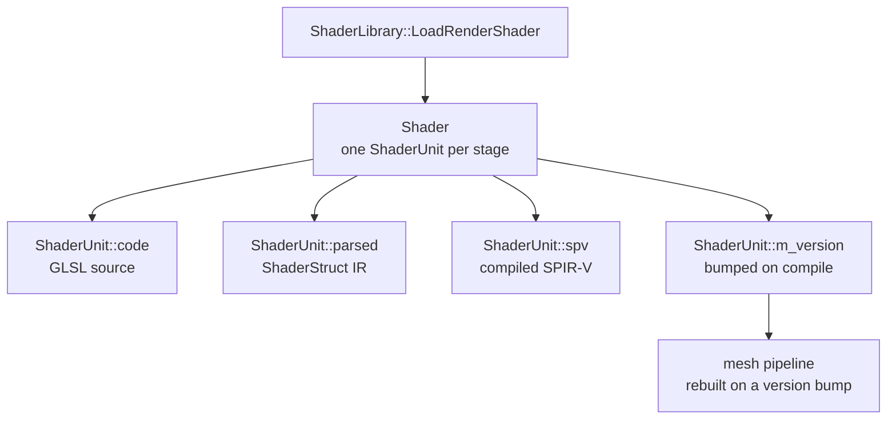

# Shaders

Per-mesh shaders are editable at runtime through the Shader Editor panel, and the whole shader pipeline lives in the renderer layer under `src/render/shaders/`.

## Shader pipeline

Only the concrete leaf shader is pooled; shaders created via `ShaderLibrary` for individual passes or tests stay outside the pool.

## Components

- `Shader.h/cpp` - per-mesh shader container (multi-stage, owns `ShaderUnit`s).
- `ShaderUnit.h` - per-stage shader state: code text, parsed IR (`ShaderStruct`), SPIR-V, version.
- `ShaderLibrary.h/cpp` - load/parse/generate/compile service for shaders.
- `ShaderParser.h/cpp` - GLSL to `ShaderStruct` IR (ShaderEditor struct mode).
- `ShaderGenerator.h/cpp` - `ShaderStruct` IR to GLSL.
- `RenderShader.h/cpp`, `ComputeShader.h/cpp` - render/compute pipeline wrappers (parsed + generated shaders).
- `ShaderCompiler.h/cpp`, `ShaderGPU.h` - SPIR-V compilation and GPU shader module.

## Edit flow

The edit flow is event-driven. The ShaderEditorPanel emits `ShaderEvents` (`ShaderCodeEdited`, `ShaderStructEdited`, `ShaderFieldAdded`), and the `ShaderController` mutates the `Mesh`'s shader data. `ShaderCreateRequested` / `ShaderCompileRequested` recompile via `ShaderLibrary::Compile` and bump `m_version`; the pipeline cache sees the new version and rebuilds the pipeline on the next frame. After create/compile, the `ShaderController` enqueues a `RenderResetEvent` so temporal shadow accumulation resets - see [Temporal](temporal.md).

## Structure mode round-trip

`ShaderParser` parses GLSL into a `ShaderStruct` IR (8 containers: attributes, pass outputs, inputs, outputs, uniforms, struct defs, functions, push constants); `ShaderGenerator` regenerates GLSL from the IR.

## Overlay shaders

The debug and gizmo overlay passes share the `overlay_line` / `overlay_point` shader pair, and the wireframe uses `debug_wire.frag`. Their behavior is described in the Debug overlay and Gizmo pass sections of [Passes](passes.md).
