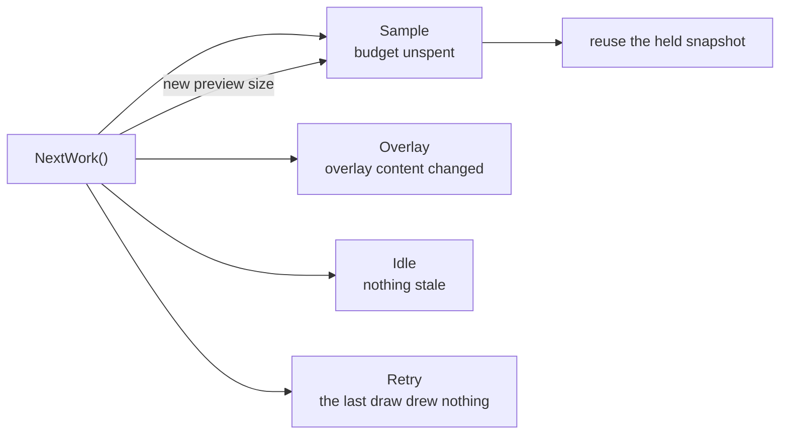

# Temporal Accumulation

Neurus accumulates jittered shadow samples across frames, restarting whenever the scene changes and stopping once a sampling budget is spent.

## Sampling budget and convergence

The renderer does not draw forever. Every restart begins a run of `r_sampling_count` scene frames (default 64, clamped to at least 1): `DeferredRenderer::r_iteration` walks `[0, N)`, one sample per `DrawFrame()`, and after the last one the image is converged and the renderer stops sampling.

What the next frame is worth is published by `IFrameRenderer::NextWork()` before the render thread waits, so the thread knows what to wait for:

- **Sample**: the budget is unspent - run the scene graph, then the overlay graph. The remaining samples reuse the last snapshot (`AcquireMode::Reuse`); they do not need a new publish.
- **Overlay**: converged, but overlay content changed (`RedrawOverlaysRequest`) - redraw the overlay graph over the converged scene image, no scene pass.
- During a resize, **Sample** draws once with the latest camera projection and the thread parks until the size changes or the resize settles.
- **Idle**: converged and nothing stale - draw nothing and acquire no swapchain image. The thread parks on the mailbox (`AcquireMode::Idle`) until a control message or a request-carrying frame arrives.
- **Retry**: the last `DrawFrame()` drew nothing (no camera, failed acquire/present) - wait for a new frame instead of redrawing a stale one.

The main thread never waits for the budget: publishing is latest-wins and non-blocking, and the renderer's state is not read back to decide when to stop.

Scene-changing requests restart the accumulated average. They ride the next published frame and execute before the renderer draws it. A resize or surface change also invalidates the held snapshot through `FrameMailbox::Invalidate()`. The mailbox carries pending requests forward to the fresh snapshot. Picking and screenshots wake the renderer to read the last drawn frame.

## Shadow accumulation

The shadow intensity pass accumulates per-light shadow samples over time, and the renderer tracks a per-frame jitter direction and an iteration counter that drive it.

- **Jitter**: a per-frame 3D random direction (unit-ball vector from `Halton(2,3,5)`) applied as `pos_jittered = pos + light.radius * jitter` for point lights, and as a UV-space offset `shadowUV + vec2(jitter.x, jitter.y) * uvRadius` for sun lights. The file `src/render/HaltonSequence.hpp` provides the low-discrepancy sequence. Only a Sample frame advances the Halton index or the iteration; an Overlay frame leaves both alone and reports zero jitter.
- **Accumulation**: in-place read-modify-write on the `ShadowIntensity` layered array. The compute shader reads the previous accumulated value via `imageLoad`, evaluates a single jittered shadow sample, and blends via EMA (exponential moving average) using `mix(prevAccum, sample, alpha)`, writing back via `imageStore`.
- **Alpha modes**: two blend modes controlled by `RenderConfig::r_sampling_mode`, read via `ctx.Frame().Settings()` so the declared default (0 = Fixed EMA) is the one a frame with no published config gets:
  - Fixed EMA (0): `alpha = 1/8` - fast convergence
  - Moving Average (1): `alpha = 1/(iteration + 1)` - true averaging, resets on scene change
- **Iteration**: `r_iteration` in `DeferredRenderer`, exposed via `RenderContext::iteration`. The Editor triggers a restart through the event system when the scene changes - see `RenderResetEvent`.
- **Reset**: any scene-changing event (camera move, light change, object transform, visibility toggle, config change, project load, asset import) enqueues a `RenderResetEvent`. The Editor subscribes and posts a `ResetAccumulationRequest`; the renderer zeros `r_iteration` when it drains any request other than `RedrawOverlaysRequest` (the reset request is simply the one that asks for exactly that).
- **Viewport resize.** Live preview reuses scene allocations while the new size fits. A mouse drag can grow the scene allocation with temporary padding. Each new projection starts from iteration zero so old shadow samples do not bleed into the new view. Settling the resize starts the normal accumulation run. A target rebuild outside preview also resets the iteration, including recovery from an out-of-date swapchain.

## Accumulation convention

The renderer's temporal accumulation follows one convention across the pipeline:

- **Iteration.** `DeferredRenderer::r_iteration` starts at zero after a scene-changing request, a viewport resize, or a target rebuild outside preview.
- **Budget**: `N = max(1, r_sampling_count)` scene frames per run, refreshed on each sample frame; `ctx.iteration` is the frame's index in `[0, N)`.
- **Jitter**: 3D jitter (`RenderContext::jitter`). Point: `pos + radius*jitter`. Sun: UV-space `shadowUV + (jitter.x, jitter.y) * uvRadius`.
- **Accumulation**: in-place read-modify-write on `ShadowIntensity` with EMA blend: `mix(prev, sample, alpha)`.
- **Alpha**: 0 = FixedAlpha (1/8), 1 = MovingAvg (1/(n+1)). Both the mode (`r_sampling_mode`) and the shadow bias are read through `ctx.Frame().Settings()`, so the only place either default is written is `RenderConfig`'s member initializers - no pass restates one.

The accumulation state lives in the `ShadowIntensity` attachments described in [Resources](resources.md), and the pass that performs it is described in [Passes](passes.md). The reset event is delivered through the event system; `RenderContext` stays an immutable per-frame snapshot throughout.
