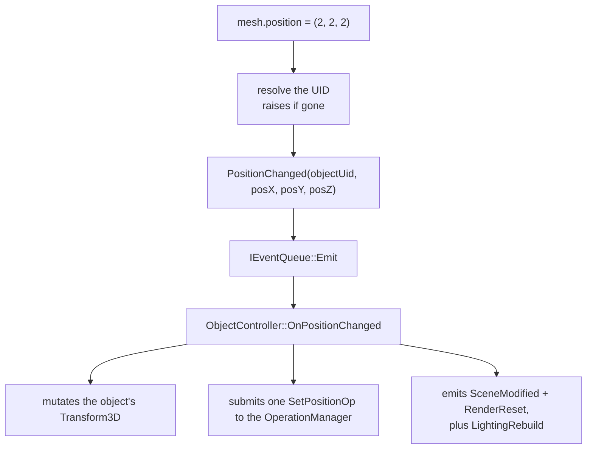

# Scripting

Neurus embeds a CPython runtime so editor actions are scriptable at runtime,
modelled on Blender's `bpy`. This document covers the script layer: where it
sits, what it exposes, and how to run a script.

## Layer placement

`src/script/` sits on the **Editor** layer and never includes Renderer or UI
headers. It exposes scene and editor state to Python for reading and writing,
and routes every mutation through the editor's typed events rather than touching
state directly. It never includes or holds the Editor: content creation is also
requested through typed events. The isolation boundary is enforced by a test
(`test/script/test_script_isolation.cpp`).

- **`ScriptEngine`** (`src/script/ScriptEngine.h`) owns the interpreter. Its
  public header is Python-free (PIMPL), so the rest of the codebase never sees a
  pybind11 or CPython type.
- **`ScriptContext`** (`src/script/ScriptContext.h`) is the read-only document
  view: borrowed `const Scene*`, `const RenderConfig*` and
  `const IResourceLookup*` pointers. The active camera and the selection are read
  live from the scene, so neither is snapshotted here; names resolve through the
  resource pool. `Editor::UpdateScriptContext()` fills it per run; the engine
  publishes it for that run and clears it afterwards.
- **`ScriptView`** (`src/script/ScriptView.h`) is the engine-owned view
  injected into every collection and proxy when it is constructed. It is a plain
  pair of pointers with no accessors; each proxy resolves its own object through
  `view->ctx` on every access. The view's address is stable for the interpreter's
  lifetime, so a proxy can outlive its run without dangling.
- **Bindings** (`src/script/bindings/`) register the embedded `neurus` module
  once.

`Application` owns the engine and is the only place Python is started, wired
through the Script Console panel and the Tools menu.

## The `neurus` module

The module is split by subject, not by layer:

- `neurus.data` - the resource pool, independent of scene membership:
  - `neurus.data.objects` - every pooled `ObjectID`, iterable and keyed by UID
    only (a name spans several object types, so a string key is ambiguous). Data
    resources (`MeshData`, `ImageData`, `Shader`) are not objects and are not
    listed.
  - `neurus.data.cameras`, `.lights`, `.meshes`, `.environments` - the whole
    resource pool filtered to one type, keyed by UID or registered name; a name
    lookup returns the typed proxy.
  - `neurus.data.scene` - the **same module object** as `neurus.scene`, not a
    second proxy, so `neurus.data.scene.meshes` reads naturally.
- `neurus.scene` - the scene currently being edited:
  - `.meshes`, `.cameras`, `.lights`, `.environments` - the same typed proxies
    restricted to objects the scene uses; a pooled object detached from the
    scene (undo history) is not listed.
  - `.objects` - every object the scene uses, keyed by UID only.
  - `.active_camera()` - the active camera proxy, or `None` when none is active.
  - `.selection()` - the selected objects as a list of `Object` proxies.
  - `.import_mesh(path, name="")`, `.add_camera(name="")` and
    `.duplicate(object, name="")` create scene content and return typed proxies,
    through typed editor events rather than a call into the Editor.
  - `.select(objects, additive=False)`, `.clear_selection()` and
    `.delete(objects)` edit selection and scene membership.
- `neurus.render.config` - the render settings (`gamma`, `pipeline`, ...).

```python
import neurus
for o in neurus.data.objects:
    print(o.name, o.transform.position)

ground = neurus.data.meshes["Ground"]
print(ground.name, ground.position, ground.rotation, ground.scale)
print("in scene:", len(neurus.scene.meshes))
print("active:", neurus.scene.active_camera())
print("selected:", [o.name for o in neurus.scene.selection()])
print("gamma", neurus.render.config.gamma)
```

`active_camera` and `selection` are **functions**, not properties: each call
reads the live scene, so a value can never be captured and go stale.

`Mesh`, `Light`, `Camera` and `Environment` proxies derive from both
`neurus.data.Object` (`uid`, `name`, `type`, `visible`, `transform`) and
`neurus.data.Transform3D` (`position`, `rotation`, `scale`), so a typed lookup
exposes both facets. A camera overrides `position`/`rotation` because its
transform is a look-at pose, and the environment's `rotation` is its
environment-map angle.

Every property is resolved live on access; nothing is cached. The engine
publishes a document only for the duration of a run. The pool-wide collections
need only the resource pool (no scene): they are empty, and a lookup returns
`None`, when the run has no resource lookup. The scene collections need only the
scene: they are non-empty when the scene has objects even if the run has no
resource lookup, and their proxies raise rather than resolving. A pool name
lookup returns `None` when the name is absent or belongs to another object type;
a scene name lookup additionally returns `None` when the name is unknown to the
pool or the object is pooled but not part of the scene.

Names come from the resource registry, not the scene: uniqueness is per concrete
object type, and a collision is suffixed (`.001`, `.002`, ...), so the name keys
are stable. See [Resource names](../core/uid-and-resources.md#resource-names).
The editor's pooled viewport camera is registered as `ViewportCamera`, so it
appears in `neurus.data.cameras` but not in `neurus.scene.cameras`.

`__getitem__` and `__contains__` agree on every collection: a UID or name that a
lookup resolves is also what `in` reports, and `objects` is UID-only in both.

## Writes

Setters write the live object. A setter resolves its target through the run's
resource pool, builds the exact typed editor event for the property, and emits it
through `ScriptDispatch::Emit`, the single funnel into the editor's synchronous
dispatch:



Dispatch is synchronous and depth-first, so every handler has run before the
setter returns: a write is visible on the very next Python statement, and a loop
can read back each value it assigns.

```python
mesh = neurus.data.meshes["Ground"]
mesh.position = (1, 2, 3)
print(mesh.position)            # (1.0, 2.0, 3.0) - already applied
```

Names, visibility, deletion and selection are writable too, each through the
same typed-event path:

```python
mesh.name = "Ground A"          # rename, one undo entry
mesh.viewport_visible = False
mesh.render_visible = True
mesh.delete()                   # remove from the scene, one undo entry

neurus.scene.select(mesh)
neurus.scene.select([mesh], additive=True)
neurus.scene.clear_selection()
neurus.scene.delete([mesh, other])
```

`visible` sets both flags at once; `viewport_visible` and `render_visible` set
them independently. Deletion removes scene membership only: the pooled object
stays alive for undo, and a later write through a stale proxy raises.

`select` reuses the live click event rather than a separate set-write event: the
first UID replaces the selection, every later one adds with Shift, and the last
UID becomes active - the same set a click gesture builds. `clear_selection()`
emits the same event with UID 0 (a background click). Each event records its own
selection entry, and the run's script scope folds them into one undo step.

### Creating content

`neurus.scene` creates meshes and cameras through the same editor path as the
CLI and the panels. It does so with typed editor events, not a call into the
Editor: the binding emits `MeshImportRequested` / `CameraAddRequested` /
`ObjectDuplicateRequested` with a borrowed result slot, the Editor (which owns
the resource pool) creates the object and fills the slot during the synchronous
dispatch, and the binding returns the typed proxy:

```python
import neurus

mesh = neurus.scene.import_mesh("res/obj/plane.obj", "Ground")
camera = neurus.scene.add_camera("Shot Camera")
copy = neurus.scene.duplicate(mesh, "Ground Copy")

camera.position = (0, -8, 3)
camera.is_active = True
```

A missing or geometry-less mesh file raises `RuntimeError` instead of adding an
empty object. Light creation remains disabled until issue #60 is fixed.
`import_mesh`, `add_camera` and `duplicate` land as one undo entry per script run.

### Application-level operations stay out of Python

Project save and snapshot capture are application-layer operations, not
document mutations, so the module does not expose them. Scripts do not reach the
Application at all: there is no `neurus.project`, no `neurus.snapshot`, and no
application host behind the run. Undo, redo, history inspection, save, open and
snapshot stay application-level operations; use the CLI or the UI for those.

Writability is a property of the resource pool, not of scene membership: a pooled
object that is not in the scene - an object held by undo history, or the pooled
viewport camera - is writable too, as long as a setter names it. A target that
has left the pool keeps its Python proxy, but the next write raises
`RuntimeError`, because the setter resolves the UID before it emits:

```python
mesh = neurus.data.meshes["Ground"]
# ... the object is removed from the pool
mesh.position = (0, 0, 0)       # RuntimeError: ... refers to a missing object
```

`Camera.is_active` is the exception: it names no object, it chooses which scene
camera the viewport looks through, so there is no target to resolve - and the
`SceneController` keeps refusing a camera the scene does not use.

`neurus.ReadOnlyError` no longer exists: there is no read-only mode left to
report, and an engine with no editor attached raises `RuntimeError` instead of
dropping the write silently.

### One undo step per run

A scripted write is recorded like a panel edit, so scripted changes undo and redo
like any other action. `ScriptEngineImpl::RunSource` brackets each run with
`ScriptRunStarted` and `ScriptRunFinished`; `ScriptController` forwards both to
the operation sink's `BeginScriptScope()` / `EndScriptScope()`, and
`OperationManager` implements them by buffering every operation the run records
and committing the buffer as one `ScriptRunOp`. The run supplies that entry's
History label: a console run shows "Run Script", a file run shows "Run <file>.py".
One `Ctrl+Z` therefore removes the whole run, not its last statement. A run that
raises still closes its scope, so the writes before the error stay as one entry; a
run that changed nothing records no entry at all. See
[Operations](../editor/operations.md#one-undo-step-per-script-run).

Scripts run on the GUI thread inside the frame loop, before `Editor::Edit()`, and
`RunSource` holds the GIL for the whole run. Controller work and the GPU uploads
a write triggers therefore execute under the GIL as well: the model is
single-threaded, and a script's cost is frame time like any other editor work.

## Environment

The interpreter is the **base** CPython that the managed environment is built on,
embedded with an isolated `PyConfig` pinned to that base prefix. The virtual
environment under `lib/.venv` (a `uv` environment owned by the `Neurus-Lib`
submodule) is attached at runtime so its site-packages are importable; that is
how a heavier package such as PyTorch is added. Preload it so its first import
does not land inside a frame.

- Provision the environment with `make update`.
- Override the environment path at configure time with
  `-DNEURUS_PYTHON_ENV=<path>` (the value is baked into the generated
  `neurus_python_config.h`).
- If the environment is missing, the interpreter still starts isolated against
  its base install.

## Imports, warm starts and hot reload

A heavy package such as PyTorch pays its first import while it runs, and that
cost lands inside a frame: the viewport stalls until the import returns. Startup
preload and hot reload remove that stall and make edited project modules
iterable without restarting the application.

### Startup preload

The Application preloads packages after the interpreter is ready and **before
the first frame**, so the cost is paid once at launch instead of on the first
script that needs the package. The list comes from exactly one source, in this
precedence:

1. `--preload NAME` on the application, repeatable and comma-separated.
2. `script.preload` in `~/.neurus/preferences.json` (a JSON array of names).
3. `NEURUS_SCRIPT_PRELOAD`, comma- or semicolon-separated.

**File -> Preferences -> Script Preload** edits the persisted list. A change is
saved immediately and applies on the next launch. `neurus open --preload NAME`
forwards the values to the spawned application as repeated `--preload`
arguments, so a background session starts warm as well.

Each result is logged and appended to the Script Console:

```text
preload json: 0.012s (loaded)
preload torch: 0.000s (cached)
preload missing_pkg failed: Traceback (most recent call last): ...
```

A failure is reported and never aborts startup: the editor opens with the
packages it could import.

`script info` reports the resident modules as `modules` (`name`, `origin`,
`seconds`, `project`, `cached`) plus `module_count` and `modules_truncated`.
The list is bounded - 200 entries in the command reply, 500 in the engine - so a
long session cannot inflate the reply.

### Import recording

The engine installs a private `sys.meta_path` finder when the interpreter
starts. It delegates to the other finders and wraps each module's loader in a
timing loader, recording the module name, its origin (`spec.origin` or
`__file__`), the wall-clock import time and the source mtime (`st_mtime_ns`).
The helper namespace is a dict held by the engine, not a module in `sys.modules`,
so user code cannot import or patch it.

A spec whose loader has no `exec_module` (a namespace package) is recorded with
zero seconds. Nested imports are recorded too, in load order.

### Hot reload

Reload roots are the directories whose modules may be re-executed:

- The project directory (parent of the open project file), or the process
  current directory when no project is open. This is set at startup and again
  after New/Open.
- For `RunFile` and `neurus script run --file`, the script's own directory for
  that run.

A run first walks the recorded modules in load order. A module is reloaded with
`importlib.reload` only when its origin is under a root, its file exists, and
its current `st_mtime_ns` is newer than the recorded value. Third-party modules
and the standard library are never reloaded, even when their files change. A
module whose mtime is unchanged is not reloaded, so a second run of unchanged
code does not re-execute its top-level code.

A successful reload is announced on the console and the run that triggered it
continues:

```text
reloaded module mymod in 0.004s
```

A failed reload names the module, is logged as an error and appended to the
console, and the new source is not executed: a broken module never runs a
half-stale mix of old and new code. Reloading happens inside the run's script
scope, so top-level writes it makes fold into the same undo step as the run.

### CLI timeout

`neurus script ...` defaults `--timeout` to 300 seconds, absorbing a first cold
import of a heavy package. Preload is the primary fix; the longer default is a
safety margin. An explicit `--timeout` always wins, and other command families
keep their own default (10 seconds).

## Running a script

Two surfaces drive the engine:

- **Script Console** (bottom dock) - paste a snippet and press `Ctrl+Enter`, or
  use **Run File...**.
- **Tools -> Run Script** - pick a `.py` file; the console dock is raised.

Output (`print`, tracebacks) appears in the console. Errors also reach the Log
panel as `NEURUS_ERR`, and never crash the host.

`stdout` is normal output; `stderr` is diagnostic output and does not by itself
fail a run. A Python exception is different: the engine records it as an error
and the CLI reports `SCRIPT_ERROR`. The engine's checked run API lets the CLI
make that distinction, so a script that only logs to `stderr` still exits
successfully.

The CLI also exposes the same engine as a document driver:

```text
neurus script run --code "print('hello')"
neurus script run -f script.py
neurus script eval "1 + 2"
neurus script info
neurus script console --tail 20
neurus script clear
```

`script eval` is expression-only; use `script run` for assignments, imports and
multi-line statements.

## Execution policy and the sandbox

The host owns exactly one sandbox policy. The two execution paths are:

- **UI runs are trusted** - the Script Console and Tools -> Run Script execute
  the user's own source with no restriction. There is no sandbox toggle in the
  Script Console, because the sandbox exists to contain untrusted source, not to
  restrict the person editing the project.
- **External runs are sandboxed** - every `neurus script run` / `script eval`
  command from the CLI, and any future agent entry point, executes under the
  host policy. The CLI cannot choose trusted mode and cannot override a policy
  field.

The policy is persisted in `~/.neurus/preferences.json` and edited in
**File -> Preferences -> Script Sandbox**:

| Field | Meaning |
|-------|---------|
| Read roots | Semicolon-separated directories the run may read. Empty uses the project directory. |
| Write roots | Semicolon-separated directories the run may write. Empty uses the project directory. |
| Blocked modules | Semicolon-separated module names the run may not import. |
| Allow network | Whether a sandboxed run may open sockets. |
| Allow subprocess | Whether a sandboxed run may create processes. |
| Allow ctypes | Whether a sandboxed run may use `ctypes`. |
| Time limit (s) | Wall-clock limit; `0` means unlimited. |
| Memory limit (MB) | Address-space limit; `0` means unlimited. |

`ScriptPolicy` (`src/script/ScriptPolicy.h`) is the Python-free value that
describes one run. `Preferences::MakeScriptPolicy(projectRoot)` builds the
external-run policy from the persisted fields; an empty root list falls back to
the project directory. `ScriptPolicy::Trusted()` is the UI-run default. A policy
is copied per run: the caller keeps ownership of what it passed.

`script info` reports the effective host policy in its `sandbox` object. It is
the same policy every external command uses, not a record of the last run.

### Enforcement points

The sandbox installs one `sys.addaudithook` hook plus an import gate in a
private dict at engine initialization. It never enters `sys.modules`.

- `open` (path, mode, flags): integer descriptors pass; reads must resolve under
  a read root, writes under a write root. `os.listdir`, `os.scandir` and
  `os.chdir` are read checks; `os.mkdir`, `os.rmdir`, `os.remove`,
  `os.chmod`, `os.chown`, `os.utime` and `os.truncate` are write checks.
  `os.rename`, `os.replace`, `os.link` and `os.symlink` check both arguments.
- Path matching uses `os.path.realpath` + `os.path.normcase` +
  `os.path.commonpath`. Another drive, a relative path with a `dir_fd`, or a
  path that cannot be normalized is a denial, not a pass.
- The interpreter's own installation (`sys.prefix`, `sys.base_prefix` and the
  entries of `sys.path`) is implicitly readable, so importing a stdlib module
  inside a sandboxed run still works. That widens reads only: writes and the
  permission flags are never widened.
- `subprocess.Popen`, `os.system`, `os.exec*`, `os.spawn*`, `os.posix_spawn`,
  `os.fork`, `os.forkpty` and `pty.spawn` are refused when subprocess creation
  is off.
- Socket connect/bind/sendto and name lookups are refused when network access is
  off; `import socket` itself stays available so a script can be written once
  and granted network later.
- Every `ctypes.*` audit event is refused when ctypes is off.
- A blocked module is refused by both a `sys.meta_path` finder and a
  `builtins.__import__` wrapper, so an already-cached module is refused too.
- The wall-clock watchdog runs outside the interpreter, acquires the GIL at the
  deadline and raises an asynchronous `_SandboxTimeout` in the running thread.
  The engine clears any pending injection after every run, so a late timeout
  cannot interrupt the next one.
- The memory limit uses Python's `resource.setrlimit(RLIMIT_AS)` where the
  platform provides it and restores the previous limit afterwards. It is
  process-wide because the interpreter has no per-run allocation cap; where it
  is unavailable the run continues unbounded and the engine logs that once.

Denials raise one of `neurus._SandboxViolation` (a `PermissionError`),
`neurus._SandboxImportViolation` (an `ImportError`) or
`neurus._SandboxTimeout`. Each message names its rule, for example
`sandbox: write outside allowed roots (rule: write_roots)`. The engine maps them
to `ScriptRunStatus::SandboxViolation` and `ScriptRunStatus::Timeout`; the
command layer reports `SCRIPT_SANDBOX_VIOLATION` or a `SCRIPT_ERROR` with
`reason: timeout`; the CLI exits `7` for the former.

### Threat model

This is a guardrail, not a security boundary. The hook runs in the same
interpreter and the same process as the code it judges: a determined script can
walk the interpreter's own objects, reach the policy record through a reference
it guesses, or block inside a C call that ignores asynchronous exceptions. Only
Python-level operations are audited; a document operation the editor performs on
the script's behalf, such as `neurus.scene.import_mesh`, reads the file through
the editor's C++ path and is not a filesystem check. The sandbox protects
against an accidental `open` of the wrong path, an accidental `subprocess` or
socket, and a runaway loop - the mistakes a normal editing session makes.

The hardening milestone is a child-process execution mode: a separate CPython
process with an OS-level sandbox, where a kill is a kill and a crash cannot take
the editor down. That mode is not implemented yet; `ScriptPolicy` and the run
status values are the seam it will plug into.
